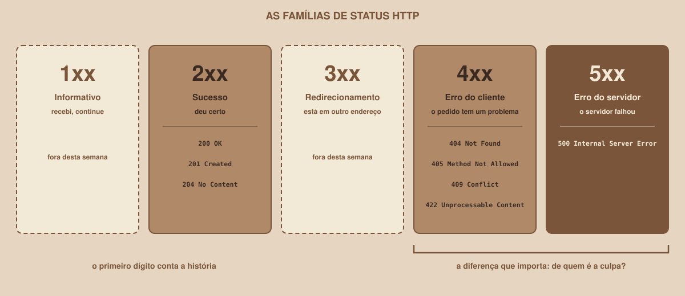

# Module 04, Status Codes

[Português](../docs/04-status-codes.md) · English

`WEEK 05 // Central RESTful API`

---

## // Before you start

The method says what the client wants to do. The **status code** says what happened. This module introduces the codes a CRUD API uses, when to return each one, and why choosing the right code matters as much as returning the right data.

## // The problem: how does the client know it worked?

Imagine an API that always responds with the same code, and reports the result only inside the body: `{"erro": "grupo não encontrado"}` or `{"ok": true}`. Each client would have to open the body and guess the format to know whether something failed. Status codes solve this: before even reading the body, the client already knows the category of the result, and any program understands the same code.

## // The five families

> **STATUS CODE: IN SIMPLE WORDS**
> It is a three-digit number, on the first line of the response, that sums up the result of the request. The **first digit** indicates the family, and the families tell a story.

<div align="center">

</div>

| Family | Meaning | In one sentence |
|---|---|---|
| **1xx** | Informational | "Got it, keep going" (rare in a CRUD API) |
| **2xx** | Success | "It worked" |
| **3xx** | Redirection | "What you are looking for is at another address" |
| **4xx** | **Client** error | "The request has a problem, and whoever asked needs to fix it" |
| **5xx** | **Server** error | "The request was correct, but I failed" |

The difference between 4xx and 5xx is the most important one in the module: it says **whose fault it is**. A 404 asks the client to fix the address. A 500 says there is nothing the client can do, and that the problem is on the server.

## // This week's API codes

| Code | Name | When to return it | Real example in the API |
|---|---|---|---|
| **200** | OK | It worked, and there is data to return | `GET /grupos/3` returns the group |
| **201** | Created | A new resource was created | `POST /grupos` returns the created group |
| **204** | No Content | It worked, and there is nothing to return | `DELETE /grupos/7` returns only the status |
| **404** | Not Found | The requested resource does not exist | `GET /grupos/99` |
| **405** | Method Not Allowed | The route exists, but does not accept this method | `DELETE /grupos` |
| **409** | Conflict | The request conflicts with the current state | Creating a group with a name already used in the subject |
| **422** | Unprocessable Content | The body or parameters have an invalid format or value | A name that is too short, or `grupo_id` equal to `abc` |
| **500** | Internal Server Error | Something went wrong inside the server | An unhandled programming error |

Other codes show up in APIs with login, like `401` (not identified) and `403` (no permission). They are outside this week's scope.

## // Each code in action

All the responses below were obtained from this week's API, while running.

**200 OK**, with the data in the body:

```
GET /grupos/3

HTTP/1.1 200 OK
{"nome_grupo":"Modelagem e SQL","materia_id":3,"max_participantes":8,"descricao":"Encontros online às terças e aos sábados","grupo_id":3,"criado_em":"2026-09-03T12:00:00Z"}
```

**201 Created**, with the new resource's address in the `Location` header:

```
POST /grupos

HTTP/1.1 201 Created
location: /grupos/7
{"nome_grupo":"Cálculo II na prática","materia_id":1,"max_participantes":5,"descricao":null,"grupo_id":7,"criado_em":"2026-10-08T12:52:39.463873Z"}
```

**204 No Content**, with no body at all:

```
DELETE /grupos/7

HTTP/1.1 204 No Content
```

**404 Not Found**, with a message in the `detail` field ("Group not found"):

```
GET /grupos/99

HTTP/1.1 404 Not Found
{"detail":"Grupo não encontrado"}
```

**405 Method Not Allowed**, with the `allow` header listing a method the route accepts:

```
DELETE /grupos

HTTP/1.1 405 Method Not Allowed
allow: GET
{"detail":"Method Not Allowed"}
```

**409 Conflict**, when repeating a `POST` that creates a group identical to another one ("A group with this name already exists in this subject"):

```
POST /grupos

HTTP/1.1 409 Conflict
{"detail":"Já existe um grupo com esse nome nessa matéria"}
```

**422**, when the value sent is invalid. FastAPI explains exactly where the problem is (`loc`) and what it is (`msg`):

```
POST /grupos  with nome_grupo equal to "ab"

HTTP/1.1 422 Unprocessable Entity
{"detail":[{"type":"string_too_short","loc":["body","nome_grupo"],"msg":"String should have at least 3 characters","input":"ab","ctx":{"min_length":3}}]}
```

**500**, when the API's own code breaks. Here, a route with a division by zero:

```
HTTP/1.1 500 Internal Server Error
Internal Server Error
```

Notice that with the 500 the server does not explain anything to the client, and that is on purpose: internal details of an error should not leak to outsiders.

> **A DETAIL ABOUT THE 422**
> The current official name of code 422 is "Unprocessable Content". Older servers, including the `uvicorn` used this week, still write "Unprocessable Entity" on the status line. In FastAPI, the old constant `HTTP_422_UNPROCESSABLE_ENTITY` is **deprecated**: Python warns you and asks you to use `HTTP_422_UNPROCESSABLE_CONTENT`. Many tutorials online still use the old name, so you will come across it.

## // How to choose between 404, 409 and 422

These are the three codes that cause the most doubt, because all three say "the request has a problem". The difference is in the kind of problem:

| Situation | Code | Why |
|---|---|---|
| The identifier in the route does not exist (`/grupos/99`) | **404** | The resource the address points to is missing |
| A value sent has an invalid format or breaks a rule (a short name, a `materia_id` that does not exist) | **422** | The request is malformed or breaks a validation rule |
| The request is valid, but collides with what already exists (a repeated name) | **409** | The format is right, but the server's current state does not allow it |

A rule of thumb: **404 is about the address, 422 is about the content, 409 is about the state.**

## // Good example × bad example

**Bad example**: always `200`, with the error inside the body:

```
GET /grupos/99

HTTP/1.1 200 OK
{"erro": true, "mensagem": "grupo não encontrado"}
```

Every client needs to know that, in this API, `200` can mean failure, and open the body to check. Tools that depend on the code, such as monitoring tools, think everything is fine.

**Good example**: the code tells the truth:

```
GET /grupos/99

HTTP/1.1 404 Not Found
{"detail":"Grupo não encontrado"}
```

## // Common mistakes

| Mistake | Why it happens | How to fix it |
|---|---|---|
| Returning `200` with an error message in the body | It is easier than choosing a code | Use the code that describes the result and leave the body just for explaining |
| Returning `500` for a client error (for example, invalid data) | An unhandled error in the code turns into a 500 | Validate the input and return `422` or `404`, and keep `500` for real failures |
| Returning `200` when creating a resource | `200` seems like the "default" success code | Use `201` and state the address in `Location` |
| Returning `204` with a body | `204` means "no content" | If there is data to return, use `200` |
| Swapping `404` and `422` | Both say "something was not found or is wrong" | `404` for the address, `422` for the content |
| Using the old name of the 422 constant | Old tutorials use `HTTP_422_UNPROCESSABLE_ENTITY` | Use `HTTP_422_UNPROCESSABLE_CONTENT` |

## // Guided practice

1. Write down, on a sheet of paper, the eight codes from the table in this section and, next to each one, a sentence in your own words explaining when to use it.
2. Reread the rule "404 is about the address, 422 is about the content, 409 is about the state" and invent, for each code, an example different from the ones in this module, using a library's `/livros` resource.

## // Practice on your own

> **CHALLENGE**
> Which code would you return in each situation for the `/grupos` resource? (a) A group was changed successfully and the response brings the updated group. (b) The person asks for `GET /grupos/abc`. (c) The person tries to delete a group that does not exist. (d) The person creates a group with `max_participantes` equal to 500, and the limit is 50. (e) A group was deleted successfully. (f) The person tries to create a group with a name another group in the same subject already uses. Check against the codes table.

## // Applying it to the week's project

1. In the `README.md`, add a "Status codes per route" section.
2. For each of the eight planned routes, write the success code and the error codes you expect (for example: `GET /grupos/{grupo_id}`: success `200`, errors `404` and `422`).
3. If you version the project with Git, make a commit: `git commit -m "Plan the status codes for each route"`.

## // Checkpoint

> **BEFORE MOVING ON, THINK ABOUT THIS**
> An API returns `500 Internal Server Error` when the person sends a `materia_id` that does not exist, because the code tries to access a nonexistent item and breaks. What is the problem, and what would the right code be?

Answer: the problem is that an error **by the person** (a value that does not exist) is being treated as an error **by the server**. The client cannot tell that the fault was in the data it sent, and whoever maintains the API gets failure alerts that are not failures. The right code is `422`, returned by an explicit check before using the value, leaving `500` only for real server failures.

## // Module summary

- [ ] I know the five status families and the difference between 4xx and 5xx.
- [ ] I know the eight codes used in this week's API and when to return each one.
- [ ] I can tell 404 (address), 422 (content) and 409 (state) apart.
- [ ] I know why you do not return `200` with an error in the body.
- [ ] I know the old 422 constant is deprecated in FastAPI.

---

**Next module:** `05-python-environment-types-and-decisions.md`: the HTTP theory is ready. Time to set up the environment and learn the language the API will be written in.

`Study Material // Coffee & Code`
