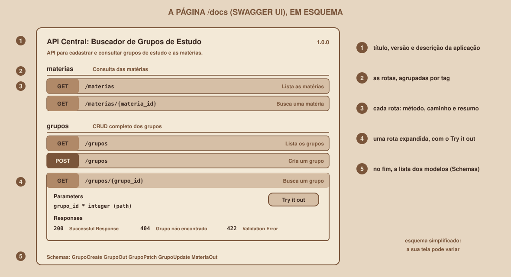

# Module 12, Swagger in Practice

[Português](../docs/12-swagger-na-pratica.md) · English

`WEEK 05 // Central RESTful API`

---

## // Before you start

The API already works, and Swagger has been there for free since Module 07. This module does two things: it teaches you to use Swagger as your main **testing tool**, and it teaches you to write documentation that an outsider understands without asking anything.

## // The problem: an API without documentation is guesswork

Whoever is going to use your API needs to know which routes exist, what to send to each one, what comes back and which errors to expect. Without that, the person guesses, gets it wrong, and ends up reading your code. Documentation solves this, and FastAPI generates it from the code itself, so it only goes out of date if the code does too.

## // OpenAPI and Swagger: two names, two things

> **OPENAPI: IN SIMPLE WORDS**
> It is a specification, that is, a standardized text format (JSON) for describing an API: the routes, the parameters, the accepted bodies and the possible responses.

> **SWAGGER UI: IN SIMPLE WORDS**
> It is a tool that reads a description in OpenAPI format and draws an interactive page, where each route can be tested. It is the `/docs` page.

The flow is: FastAPI **reads your code** and builds the OpenAPI at `/openapi.json`; Swagger UI **reads the OpenAPI** and draws `/docs`. The alternative page `/redoc` reads the same file.

## // OpenAPI inside

Open `http://127.0.0.1:8000/openapi.json`. The file has five main blocks:

| Block | What it contains |
|---|---|
| `openapi` | The specification version (in this API, `3.1.0`) |
| `info` | The API's title, description and version |
| `paths` | Each route, and inside it each method with its parameters and responses |
| `components` | The reused models (the "schemas") |
| `tags` | The description of the route groups |

This API has four paths (`/materias`, `/materias/{materia_id}`, `/grupos` and `/grupos/{grupo_id}`) and seven models, among them `GrupoCreate`, `GrupoOut`, `GrupoPatch`, `GrupoUpdate` and `MateriaOut`. This is the real snippet for the `GET /materias/{materia_id}` route:

```json
{
  "tags": ["materias"],
  "summary": "Busca uma matéria pelo identificador",
  "operationId": "buscar_materia_materias__materia_id__get",
  "parameters": [
    {
      "name": "materia_id",
      "in": "path",
      "required": true,
      "schema": {"type": "integer", "title": "Materia Id"}
    }
  ],
  "responses": {
    "200": {"description": "Successful Response", "content": {"application/json": {"schema": {"$ref": "#/components/schemas/MateriaOut"}}}},
    "404": {"description": "Matéria não encontrada"},
    "422": {"description": "Validation Error", "content": {"application/json": {"schema": {"$ref": "#/components/schemas/HTTPValidationError"}}}}
  }
}
```

(The real file comes more compactly formatted; here it was organized for reading.) Compare it with the route's code: `materia_id: int` became `"type": "integer"`, `response_model=MateriaOut` became the reference in the `200` response, and `responses={404: ...}` became the `404` entry. The `422` came in on its own, because every route with parameters can fail validation.

## // Anatomy of the /docs page

<div align="center">

</div>

The diagram is a simplification, and your screen may differ slightly. The structure is this:

- **At the top:** the title, version and description you wrote in `FastAPI(...)`.
- **The groups (tags):** the routes show up grouped by `tag` name.
- **Each route:** a row with the method (each one in its own color), the path and the summary.
- **An expanded route:** the parameters, the request body (with an editable example), the **Try it out** button and the possible responses.
- **At the bottom:** the **Schemas** section, with all the models.

## // Using Swagger as a testing tool

This is the routine to test any route:

1. **Expand** the route by clicking on it.
2. Click **Try it out**. The fields become editable.
3. Fill in the parameters and, if there is one, edit the **body** (the text area already comes with the example).
4. Click **Execute**.
5. Read the result under **Server response**: the **code**, the **body** (*Response body*) and the **headers** (*Response headers*).
6. Compare it with the **Responses** section right below, which lists what the route **promises** to return.

Swagger also shows the `curl` command equivalent to what you just ran. It is a great way to learn `curl` syntax without typing.

For `POST /grupos`, the body comes filled in with the example in the `GrupoCreate` model, thanks to this piece of code:

```python
model_config = ConfigDict(
    json_schema_extra={
        "examples": [
            {
                "nome_grupo": "Cálculo II na prática",
                "materia_id": 1,
                "max_participantes": 5,
                "descricao": "Listas de exercícios às quartas",
            }
        ]
    }
)
```

## // Documenting in the code

What shows up in Swagger comes from these places in the code:

| Where you write it | Shows up in Swagger as | Example |
|---|---|---|
| `FastAPI(title=..., description=..., version=...)` | The page header. The description accepts **Markdown** | `title="API Central: Buscador de Grupos de Estudo"` |
| `openapi_tags=[{"name": ..., "description": ...}]` | The description of each route group | `{"name": "grupos", "description": "CRUD completo dos grupos de estudo."}` |
| `summary="..."` in the decorator | The text next to each route | `summary="Cria um grupo"` |
| `responses={404: {"description": "..."}}` | The list of possible responses | `responses={404: {"description": "Grupo não encontrado"}}` |
| `Field(description="...")` in the model | The explanation of each field | `Field(description="Nome do grupo de estudo")` |

And what FastAPI fills in **on its own** when you do not write anything:

```python
@app.get("/grupos")
def listar_grupos():
    """Devolve todos os grupos cadastrados."""
    return []
```

| Field | Generated value |
|---|---|
| `summary` | `Listar Grupos` (the function name, capitalized and with spaces) |
| `description` | `Devolve todos os grupos cadastrados.` (the function's **docstring**) |
| `operationId` | `listar_grupos_grupos_get` |

That is why naming functions well already documents half the API. A function called `f1` becomes, in Swagger, a route with the summary `F1`, which helps nobody.

## // Public documentation also reveals your API

Whoever opens `/docs` sees every route and every field, and `/openapi.json` delivers the same information in a machine format. To hide the documentation:

```python
app = FastAPI(docs_url=None, redoc_url=None)
```

> **TURNING OFF /DOCS DOES NOT HIDE THE OPENAPI**
> In this week's test, an application created with `docs_url=None` and `redoc_url=None` started responding **404** at `/docs` and `/redoc`, but `/openapi.json` **kept responding 200**. To turn everything off, you also need `openapi_url=None`. This week the API runs only on your computer, so leave the documentation on: it is your best study tool.

## // Good example × bad example

**Bad example**: routes with no summary, description or documented responses:

```python
@app.post("/grupos", status_code=201)
def f(g: GrupoCreate): ...
```

Swagger shows an "F" route, with no indication that it can return `409` or `422`.

**Good example**: documentation that anticipates questions:

```python
@app.post(
    "/grupos",
    status_code=201,
    summary="Cria um grupo",
    responses={
        409: {"description": "Já existe um grupo com esse nome nessa matéria"},
        422: {"description": "Dados inválidos, ou matéria inexistente"},
    },
)
def criar_grupo(novo: GrupoCreate): ...
```

## // Common mistakes

| Mistake | Why it happens | How to fix it |
|---|---|---|
| The `/docs` page opens blank | No internet to load Swagger's files | Connect and reload |
| Swagger shows the `422` but not the `404` | The `404` is raised in the code, and FastAPI does not guess it | Declare `responses={404: {...}}` |
| The example body comes with meaningless values (`"string"`, `0`) | No example was defined in the model | Use `json_schema_extra` with `examples` |
| Swagger does not reflect a change | The server did not reload, or the page is cached | Check the terminal and reload the page |
| The test works in Swagger, but `curl` gives a `422` | `curl` forgot the `Content-Type` | Copy the `curl` that Swagger itself generates |
| Documenting a response the route does not return | The code changed and the documentation did not | Review `responses` whenever you change the rules |

## // Guided practice

1. Open `/openapi.json` and find: `info`, the four paths and the `GrupoCreate` model.
2. In `/docs`, go through every route and run each one with **Try it out**.
3. In `POST /grupos`, edit the body to cause a `409` and a `422`, and compare the response with the **Responses** section.
4. Copy the `curl` command Swagger shows for a route and run it in the terminal.
5. Change a route's `summary` and check the change in `/docs` after saving.

## // Practice on your own

> **CHALLENGE**
> Pick three routes in your API without a `summary` or without complete `responses`, and document them. For each one, add the `summary` and every error response it can return (use the codes table from Module 11). Check in `/docs` whether each response showed up in the list.

## // Applying it to the week's project

1. Make sure the `FastAPI(...)` in `main.py` has `title`, `description` and `version`, and that the tags are described in `openapi_tags`.
2. Make sure every route has a `summary` and that the ones that can fail have `responses`.
3. Save in the `README.md` a snippet of `/openapi.json` (for example, the `GET /grupos/{grupo_id}` route) and explain, in one line, how the code generated each part.
4. If you version the project with Git, make a commit: `git commit -m "Document the API for Swagger"`.

## // Checkpoint

> **BEFORE MOVING ON, THINK ABOUT THIS**
> You changed a `404`'s error message in the code, but forgot to update the decorator's `responses={404: {"description": "..."}}`. What does Swagger show, and what does the API actually return?

Answer: Swagger shows the **old** description, because it comes from the hand-written `responses`, not from the message the function raises. The API returns the **new** message. It is one of the few places where documentation can go out of date, which is why `responses` describes the **kind** of response ("Group not found"), not a text that keeps changing.

## // Module summary

- [ ] I know the difference between OpenAPI (the description) and Swagger UI (the page).
- [ ] I know the five blocks of `/openapi.json` and how the code becomes each part.
- [ ] I can test any route in Swagger: **Try it out**, **Execute** and **Server response**.
- [ ] I can document with `title`, `description`, `tags`, `summary`, `responses` and `Field`.
- [ ] I know what FastAPI fills in on its own (summary and docstring).
- [ ] I know that turning off `/docs` does not turn off `/openapi.json`.

---

**Next module:** `13-guided-project.md`: all the pieces are ready. Time to put the complete API together from start to finish.

`Study Material // Coffee & Code`
