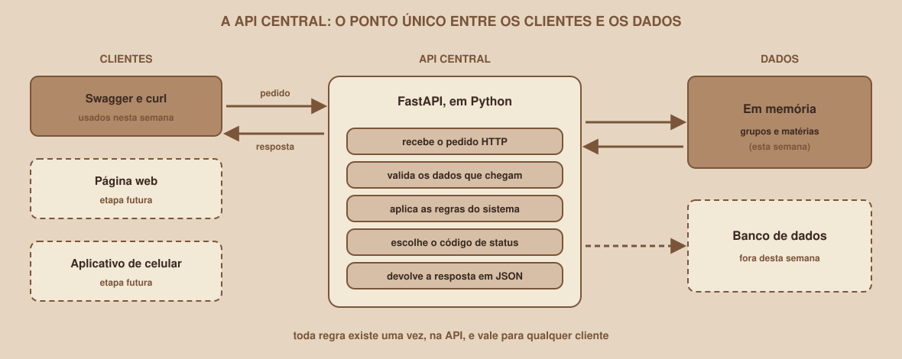

# Módulo 00, Comece Aqui

Português · [English](../docs-eng/00-start-here.md)

`SEM 05 // API RESTful Central`

---

## // Bem-vindo à Semana 05

Imagine o **Buscador de Grupos de Estudo**, uma aplicação em que estudantes procuram grupos de estudo de cada matéria. Na tela aparece uma lista de grupos, um formulário para criar um grupo novo e um botão para apagar. Mas de onde vêm esses grupos? Onde eles ficam guardados enquanto ninguém está com a tela aberta? E quem garante que um grupo não seja criado com um nome vazio, ou apagado duas vezes?

A resposta é um programa que fica entre as telas e os dados, recebendo pedidos, aplicando as regras e devolvendo respostas. Esse programa é a **API central**, e esta semana você constrói a primeira versão dela, do zero, em Python.

## // O que é uma API central

> **API CENTRAL: EM PALAVRAS SIMPLES**
> É um programa que fica ligado o tempo todo, recebe pedidos pela rede (usando o protocolo HTTP), aplica as regras do sistema e devolve respostas. É "central" porque é o ponto único por onde passam os pedidos de qualquer cliente: uma página web, um aplicativo de celular ou outro programa.

O benefício de ter um ponto único é que as regras moram em um lugar só. Se a regra "o nome do grupo precisa ter pelo menos 3 caracteres" estivesse espalhada em cada tela, bastaria uma tela esquecer de aplicá-la para o sistema aceitar dados inválidos. Na API central, a regra existe uma vez e vale para todos os clientes.

## // O que você vai construir até o fim da semana

- Uma API em **Python**, usando o framework **FastAPI**, que roda no seu próprio computador.
- As operações de **CRUD** de grupos de estudo: listar, buscar um, criar, substituir, alterar e apagar. Mais a leitura das matérias.
- Validação automática dos dados que chegam, com mensagens de erro claras.
- **Códigos de status** corretos em cada situação: 200, 201, 204, 404, 409, 422.
- Uma documentação interativa, o **Swagger**, que o FastAPI gera sozinho e onde você testa a API sem escrever nenhum cliente.

## // O que ainda fica de fora

> **AINDA NÃO NESTA SEMANA**
> Nesta primeira parte, os dados ficam **em memória**: eles vivem em variáveis do Python e voltam ao estado inicial sempre que o servidor é reiniciado. Também ficam de fora o banco de dados, o login e as permissões, a publicação da API na internet e qualquer tela conectada a ela. Esta semana é sobre construir e entender a API em si.

## // O que você precisa para começar

- Um computador com Windows, macOS ou Linux, e permissão para instalar programas.
- Um editor de texto ou de código (qualquer um serve) e um terminal.
- Um navegador.
- Conexão com a internet, para instalar pacotes e para a página de documentação carregar (o Módulo 07 explica o porquê).
- **Nenhum conhecimento prévio** de Python, de HTTP ou de APIs. Tudo é apresentado a partir do zero, e esta semana não depende de nenhuma outra.

## // As duas trilhas

**Se você está começando**, nunca escreveu uma API. O caminho principal assume isso: os Módulos 01 a 13 apresentam cada conceito antes de ele ser necessário, com foco em rotas CRUD básicas e no Swagger.

**Se você já tem experiência**, já construiu alguma API ou conhece outra linguagem. Os Módulos 14 a 16, claramente identificados como trilha veterano e posicionados depois do essencial, cobrem a organização da API em camadas, a Clean Architecture e o tratamento global de erros. Os Módulos 17 e 18 são bônus da mesma trilha: testes automatizados, e filtros, ordenação e paginação.

As duas trilhas constroem a mesma API. O que muda entre elas é a profundidade.

## // Mapa da Semana 05

| Módulo | Conteúdo | Você vai conseguir |
|---|---|---|
| 01 | O que é uma API REST | Explicar recursos, rotas e JSON |
| 02 | HTTP na prática | Ler uma requisição e uma resposta |
| 03 | Métodos HTTP | Escolher o método certo para cada ação |
| 04 | Status codes | Escolher o código certo para cada resultado |
| 05 | Python: ambiente, tipos e decisões | Preparar o ambiente e escrever os primeiros programas |
| 06 | Python: funções, listas e dicionários | Organizar dados e lógica em Python |
| 07 | Sua primeira API com FastAPI | Rodar uma API e abrir o Swagger |
| 08 | Rotas e parâmetros | Receber valores pela URL, com validação |
| 09 | Modelos com Pydantic | Receber e devolver dados com formato garantido |
| 10 | CRUD: lendo dados | Implementar a leitura, com o 404 |
| 11 | CRUD: criar, atualizar e apagar | Implementar a escrita, com 201, 204 e 409 |
| 12 | Swagger na prática | Documentar e testar a API pelo navegador |
| 13 | Projeto guiado | Ter a API completa funcionando |
| 14 | Organizando uma API em camadas (veterano) | Dividir a API em pacotes, routers e camadas |
| 15 | Clean Architecture no FastAPI (veterano) | Manter as regras livres do framework |
| 16 | Tratamento global de erros (veterano) | Traduzir todo erro em um formato único |
| 17 | Testes automatizados (veterano, bônus) | Testar a API com `pytest` |
| 18 | Filtros, ordenação e paginação (veterano, bônus) | Devolver listas grandes com controle |

Cada módulo é um arquivo independente, mas foram escritos para serem lidos nesta ordem: o código só faz sentido depois de entender o HTTP, e o CRUD só faz sentido depois de entender os modelos.

---

**Próximo módulo:** `01-o-que-e-uma-api-rest.md`: antes de escrever qualquer código, entenda o que é uma API e por que ela segue um estilo chamado REST.

`Material de Estudo // Coffee & Code`
