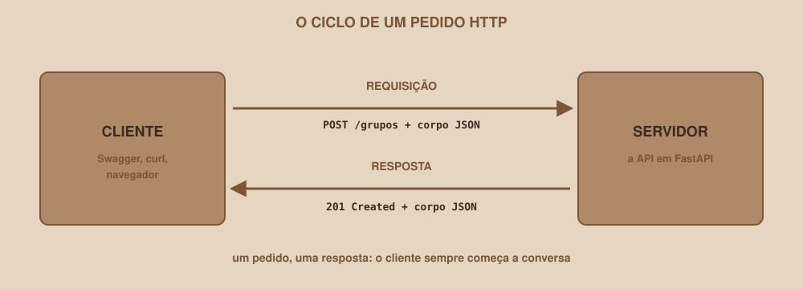
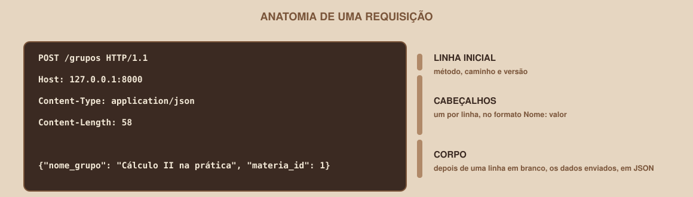
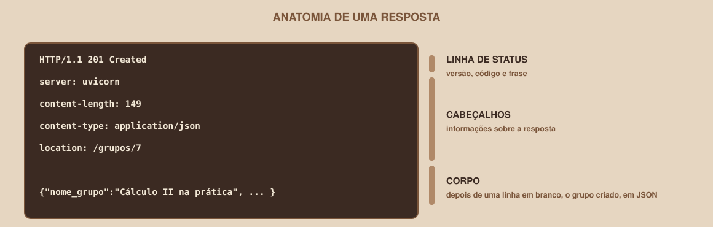

# Módulo 02, HTTP na Prática

Português · [English](../docs-eng/02-http-in-practice.md)

`SEM 05 // API RESTful Central`

---

## // Antes de começar

No Módulo 01 você viu que cliente e servidor conversam por pedidos e respostas. Este módulo abre essa conversa e mostra como ela é por dentro. Saber ler uma requisição e uma resposta é o que permite, mais adiante, entender mensagens de erro e depurar a API com segurança.

## // O problema: o que exatamente viaja pela rede?

Quando você abre uma página ou chama uma API, algo é enviado e algo volta. Sem enxergar esse "algo", qualquer erro parece mágica. A boa notícia é que o HTTP é um protocolo de **texto**, legível por pessoas.

## // O que é o HTTP

> **HTTP: EM PALAVRAS SIMPLES**
> É o protocolo, ou seja, o conjunto de regras de conversa, usado entre navegadores, aplicativos e servidores na web. Funciona por **pedido e resposta**: o cliente envia uma **requisição**, e o servidor devolve uma **resposta**.

<div align="center">

</div>

Cada requisição recebe exatamente uma resposta. Quando o servidor responde, a conversa daquele pedido termina.

## // Anatomia de uma requisição

Esta é uma requisição para criar um grupo, escrita como ela viaja pela rede:

```
POST /grupos HTTP/1.1
Host: 127.0.0.1:8000
Content-Type: application/json
Content-Length: 58

{"nome_grupo": "Cálculo II na prática", "materia_id": 1}
```

<div align="center">

</div>

| Parte | O que contém | No exemplo |
|---|---|---|
| **Linha inicial** | O método, o caminho e a versão do HTTP | `POST /grupos HTTP/1.1` |
| **Cabeçalhos** | Informações sobre o pedido, uma por linha, no formato `Nome: valor` | `Content-Type: application/json` |
| **Linha em branco** | Separa os cabeçalhos do corpo | (vazia) |
| **Corpo** | Os dados enviados, quando existem | O JSON do grupo |

Nem toda requisição tem corpo. Um `GET` que apenas lê dados costuma ir só com a linha inicial e os cabeçalhos.

## // Anatomia de uma resposta

Esta é a resposta real que a API desta semana devolve ao pedido acima (o servidor também envia o cabeçalho `date`, omitido aqui para encurtar):

```
HTTP/1.1 201 Created
server: uvicorn
content-length: 149
content-type: application/json
location: /grupos/7

{"nome_grupo":"Cálculo II na prática","materia_id":1,"max_participantes":5,"descricao":null,"grupo_id":7,"criado_em":"2026-10-08T12:52:39.463873Z"}
```

<div align="center">

</div>

| Parte | O que contém | No exemplo |
|---|---|---|
| **Linha de status** | A versão, o **código de status** e a frase que o descreve | `HTTP/1.1 201 Created` |
| **Cabeçalhos** | Informações sobre a resposta | `location: /grupos/7` |
| **Corpo** | Os dados devolvidos, quando existem | O grupo recém-criado, em JSON |

O código de status é o que diz, antes de qualquer outra coisa, se o pedido deu certo. O Módulo 04 é inteiro sobre ele.

## // A URL por dentro

```
http://127.0.0.1:8000/grupos?q=prática&materia_id=1
```

| Parte | Valor no exemplo | Significado |
|---|---|---|
| Esquema | `http` | O protocolo usado |
| Host | `127.0.0.1` | O computador que atende. `127.0.0.1` (ou `localhost`) é o seu próprio computador |
| Porta | `8000` | A "porta de entrada" do programa naquele computador |
| Caminho | `/grupos` | O recurso procurado |
| Query string | `?q=prática&materia_id=1` | Parâmetros extras, no formato `nome=valor`, separados por `&` |

Quando você rodar a API no seu computador, o host será sempre `127.0.0.1` e a porta será a `8000`, a menos que você escolha outra.

## // Os cabeçalhos que você vai encontrar

| Cabeçalho | Quem envia | Para que serve |
|---|---|---|
| `Content-Type` | Cliente e servidor | Diz o formato do corpo. Para JSON, é `application/json` |
| `Content-Length` | Cliente e servidor | O tamanho do corpo, em bytes |
| `Host` | Cliente | O servidor e a porta de destino |
| `Location` | Servidor | O endereço do recurso recém-criado |
| `Allow` | Servidor | Os métodos aceitos por uma rota (aparece nas respostas 405) |
| `Date` e `Server` | Servidor | A data da resposta e o programa que respondeu (aqui, `uvicorn`) |

## // Como enviar requisições

| Ferramenta | O que faz bem | Limitação |
|---|---|---|
| **Navegador** | Enviar `GET` digitando o endereço | Não envia corpo nem outros métodos |
| **Swagger** (Módulo 07 em diante) | Enviar qualquer método, preenchendo formulários | Só existe depois que a API roda |
| **curl** | Enviar qualquer método, pelo terminal | Exige cuidado com aspas e cabeçalhos |
| **Ferramentas do navegador** (tecla F12, aba Rede) | Ver as requisições que uma página já faz | Mostra, mas não cria pedidos novos com facilidade |

O `curl` aceita quatro opções que cobrem quase tudo nesta semana:

| Opção | Significado |
|---|---|
| `-i` | Mostra os cabeçalhos da resposta, além do corpo |
| `-X MÉTODO` | Escolhe o método (`-X POST`, `-X DELETE`) |
| `-H "Nome: valor"` | Acrescenta um cabeçalho |
| `-d 'texto'` | Define o corpo da requisição |

```
curl -i -X POST http://127.0.0.1:8000/grupos \
  -H "Content-Type: application/json" \
  -d '{"nome_grupo": "Cálculo II na prática", "materia_id": 1}'
```

> **ATENÇÃO NO WINDOWS**
> No PowerShell do Windows, `curl` é um apelido de outro comando, e o `curl` de verdade se chama `curl.exe`. Além disso, as aspas dentro do JSON costumam exigir um tratamento diferente do que está acima. Os comandos deste material foram executados em Linux e **não foram testados no Windows**. Se tiver dificuldade, use o Swagger (Módulo 07 em diante), que funciona igual em qualquer sistema e não exige aspas.

> **O CABEÇALHO MAIS ESQUECIDO**
> Ao enviar JSON, o cliente precisa informar `Content-Type: application/json`. Nas versões atuais do FastAPI, uma requisição com corpo JSON **sem esse cabeçalho** é recusada com o código 422 e uma mensagem pouco clara ("Input should be a valid dictionary or object to extract fields from"). O Swagger e o `curl -d` com `-H` enviam o cabeçalho certo, mas quem esquece o `-H` no `curl` cai nessa armadilha.

## // Bom exemplo × mau exemplo

**Mau exemplo**: enviar o JSON sem o cabeçalho:

```
curl -i -X POST http://127.0.0.1:8000/grupos \
  -d '{"nome_grupo": "Sem cabecalho", "materia_id": 1}'
```

```
HTTP/1.1 422 Unprocessable Entity
{"detail":[{"type":"model_attributes_type","loc":["body"],"msg":"Input should be a valid dictionary or object to extract fields from", ...}]}
```

O servidor não sabe que o corpo é JSON, e a mensagem de erro não menciona o cabeçalho.

**Bom exemplo**: informar o formato do corpo:

```
curl -i -X POST http://127.0.0.1:8000/grupos \
  -H "Content-Type: application/json" \
  -d '{"nome_grupo": "Cálculo II na prática", "materia_id": 1}'
```

O resultado é o `201 Created` mostrado na seção sobre respostas.

## // Erros comuns

| Erro | Por que acontece | Como corrigir |
|---|---|---|
| 422 ao enviar JSON pelo `curl` | Faltou `-H "Content-Type: application/json"` | Acrescente o cabeçalho |
| `curl: (7) Failed to connect` | A API não está rodando, ou a porta é outra | Confira se o servidor está no ar e qual porta ele usa |
| Tentar enviar um `POST` digitando o endereço no navegador | O navegador só envia `GET` ao abrir um endereço | Use o Swagger ou o `curl` |
| Confundir o caminho com a URL inteira | A URL tem várias partes | O caminho é só a parte que começa na primeira `/` depois da porta |
| Esquecer as aspas em volta da URL com `&` no terminal | O `&` tem significado especial em alguns terminais | Coloque a URL entre aspas |

## // Prática guiada

1. Abra qualquer site no navegador e pressione a tecla **F12**.
2. Abra a aba **Rede** (em inglês, *Network*) e recarregue a página.
3. Clique na primeira linha da lista e procure: o **método**, o **código de status**, o `Content-Type` da resposta e o tamanho.
4. Repita com outra linha da lista (uma imagem ou um arquivo de estilo) e compare os `Content-Type`.

## // Pratique sozinho

> **DESAFIO**
> Leia a requisição abaixo e responda: qual é o método, o caminho, quantos cabeçalhos existem e qual é o corpo?

```
PATCH /grupos/3 HTTP/1.1
Host: 127.0.0.1:8000
Content-Type: application/json
Content-Length: 25

{"max_participantes": 12}
```

## // Aplicando no projeto da semana

1. No `README.md` da pasta `api-grupos`, acrescente a seção "Como são os pedidos".
2. Escreva nela, no formato desta seção, uma requisição `POST /grupos` com um corpo JSON de um grupo que você inventar, e a resposta `201 Created` que você espera receber.
3. Se você versiona o projeto com Git, faça um commit: `git commit -m "Documenta um exemplo de requisição e resposta"`.

## // Checkpoint

> **ANTES DE SEGUIR, PENSE NISTO**
> Por que uma requisição `POST` com corpo em JSON precisa do cabeçalho `Content-Type: application/json`? O que o servidor não saberia sem ele?

Resposta: porque o corpo chega apenas como uma sequência de caracteres, e o servidor não tem como adivinhar se ela é JSON, texto comum, dados de um formulário ou outra coisa. O `Content-Type` diz como interpretá-la. Sem ele, o FastAPI não trata o corpo como JSON e a validação falha com um 422.

## // Resumo do módulo

- [ ] Sei explicar o que é o HTTP e o que é um pedido e uma resposta.
- [ ] Sei identificar as partes de uma requisição (linha inicial, cabeçalhos e corpo).
- [ ] Sei identificar as partes de uma resposta (linha de status, cabeçalhos e corpo).
- [ ] Sei dividir uma URL em esquema, host, porta, caminho e query string.
- [ ] Sei por que o `Content-Type: application/json` é obrigatório ao enviar JSON.

---

**Próximo módulo:** `03-metodos-http.md`: a primeira palavra de uma requisição é o método. Ele diz qual ação você quer fazer com o recurso.

`Material de Estudo // Coffee & Code`
