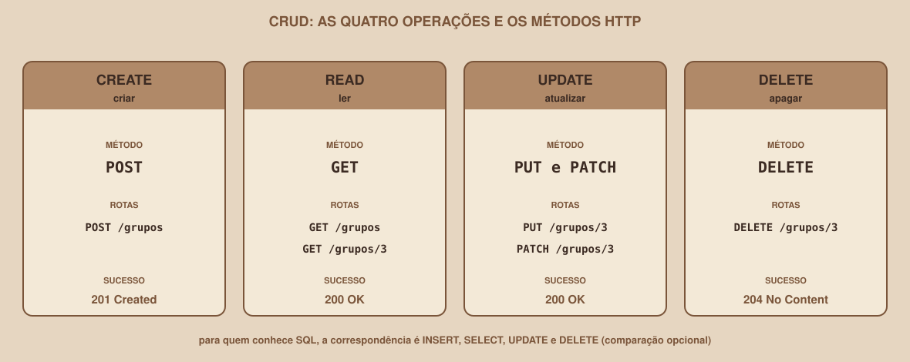

# Módulo 03, Métodos HTTP

`SEM 05 // API RESTful Central`

---

## // Antes de começar

No Módulo 02 você viu que toda requisição começa com um método, como `GET` ou `POST`. Este módulo explica o que cada método quer dizer, quando usar cada um, e duas propriedades importantes que eles têm: ser **seguro** e ser **idempotente**.

## // O problema: o mesmo endereço, ações diferentes

A rota `/grupos/3` representa um grupo. Mas o que você quer fazer com ele? Ler? Trocar os dados? Apagar? Colocar a ação dentro do endereço (`/apagarGrupo/3`) gera o caos que o Módulo 01 descreveu. A solução do HTTP é manter o endereço fixo e usar o **método** para dizer a ação.

## // Os cinco métodos do CRUD

> **CRUD: EM PALAVRAS SIMPLES**
> É a sigla das quatro operações básicas sobre qualquer dado: **C**reate (criar), **R**ead (ler), **U**pdate (atualizar) e **D**elete (apagar). Quase toda API é, no fundo, um CRUD sobre algum recurso.

<div align="center">

</div>

| Operação | Método | Para que serve | Tem corpo? |
|---|---|---|---|
| Ler | `GET` | Obter um recurso ou uma coleção | Não |
| Criar | `POST` | Criar um recurso novo na coleção | Sim |
| Substituir | `PUT` | Trocar um recurso inteiro por uma versão nova | Sim |
| Alterar parte | `PATCH` | Mudar só alguns campos de um recurso | Sim |
| Apagar | `DELETE` | Remover um recurso | Não |

> **PARA QUEM JÁ CONHECE SQL (OPCIONAL)**
> Se você já conhece bancos de dados, as correspondências são: `GET` equivale a `SELECT`, `POST` a `INSERT`, `PUT` e `PATCH` a `UPDATE`, e `DELETE` a `DELETE`. Esta semana não usa banco de dados, então isso é só uma comparação: nada do que vem a seguir depende disso.

## // Seguro e idempotente

Dois conceitos distinguem os métodos entre si, e entendê-los evita bugs difíceis de achar.

> **SEGURO: EM PALAVRAS SIMPLES**
> Um método é seguro quando **não altera nada** no servidor. Chamá-lo é como olhar uma vitrine: pode ser feito à vontade, sem consequências.

> **IDEMPOTENTE: EM PALAVRAS SIMPLES**
> Um método é idempotente quando repetir o mesmo pedido várias vezes deixa o servidor no **mesmo estado** que um pedido só. O resultado final não muda, mesmo que a resposta mude.

| Método | Seguro? | Idempotente? |
|---|---|---|
| `GET` | Sim | Sim |
| `POST` | Não | Não |
| `PUT` | Não | Sim |
| `PATCH` | Não | Não é garantido |
| `DELETE` | Não | Sim |

Os exemplos reais da API desta semana mostram a diferença:

- **DELETE é idempotente.** Apagar o grupo 7 uma vez devolve `204 No Content`. Apagar de novo devolve `404 Not Found`. A resposta mudou, mas o estado final é o mesmo nas duas vezes: o grupo 7 não existe.
- **POST não é idempotente.** Enviar o mesmo `POST /grupos` duas vezes tenta criar dois grupos. Na API do projeto, uma regra impede o segundo (`409 Conflict`), mas sem essa regra seriam criados dois grupos iguais.
- **GET é seguro.** Chamar `GET /grupos` mil vezes não muda nenhum grupo.

## // PUT × PATCH: substituir ou alterar

Os dois mudam um recurso que já existe, mas de formas diferentes.

- **PUT** envia o recurso **inteiro**. O que não for enviado volta ao valor padrão.
- **PATCH** envia **só os campos que mudam**. Os demais permanecem como estavam.

Na API do projeto, o grupo 3 tem `max_participantes` igual a 8 e uma descrição. Este `PATCH` muda só o limite:

```
PATCH /grupos/3
{"max_participantes": 12}
```

O nome e a descrição continuam intactos. Já um `PUT` que envie só `nome_grupo` e `materia_id` faz o `max_participantes` voltar ao valor padrão (10) e a descrição ficar vazia, porque o `PUT` substitui o grupo inteiro.

## // Bom exemplo × mau exemplo

**Mau exemplo**: apagar com `GET`:

```
GET /apagarGrupo?id=3
```

Um `GET` deve ser seguro. Navegadores e programas que visitam links automaticamente podem repetir um `GET` sem que ninguém perceba, e cada visita apagaria um grupo.

**Bom exemplo**: apagar com `DELETE`:

```
DELETE /grupos/3
```

O método deixa a intenção explícita, e nenhum programa dispara um `DELETE` por acidente ao seguir um link.

## // Erros comuns

| Erro | Por que acontece | Como corrigir |
|---|---|---|
| Usar `POST` para tudo | Funciona e é fácil de lembrar | Escolha o método pelo significado: ler é `GET`, apagar é `DELETE` |
| Alterar dados com `GET` | Dá para fazer, então parece válido | O `GET` deve ser seguro. Use `PUT`, `PATCH`, `POST` ou `DELETE` |
| Confundir `PUT` e `PATCH` | Os dois "atualizam" | `PUT` envia tudo e substitui, `PATCH` envia só o que muda |
| Enviar corpo em um `GET` ou `DELETE` | Parece natural mandar o identificador no corpo | O identificador vai na rota (`/grupos/3`), e não no corpo |
| Achar que repetir um `POST` é inofensivo | Parece só "mandar de novo" | `POST` não é idempotente: repetir pode criar duplicatas |

## // Prática guiada

1. Imagine uma biblioteca com o recurso `/livros`. Escreva a rota e o método para: listar todos os livros, ver um livro, cadastrar um livro, trocar todos os dados de um livro, corrigir só o título de um livro, e remover um livro.
2. Para cada operação, marque se o método é seguro e se é idempotente.
3. Confira o seu palpite do desafio do Módulo 01 (`/buscarMateria?id=2`, `/atualizarGrupo`, `/removerGrupo?id=5`): quais métodos você escolheria agora?

## // Pratique sozinho

> **DESAFIO**
> O botão "Salvar" de um formulário envia um `POST` para criar um grupo. A pessoa, impaciente, clica nele duas vezes seguidas. Descreva o que pode acontecer no servidor, e explique por que usar `PUT` em um endereço que já contém o identificador do grupo evitaria o problema.

## // Aplicando no projeto da semana

1. No `README.md`, complete a tabela "Rotas planejadas" do Módulo 01 com uma nova coluna: **seguro?** e **idempotente?**.
2. Acrescente duas linhas explicando, com as suas palavras, a diferença entre `PUT` e `PATCH` no contexto do recurso `/grupos`.
3. Se você versiona o projeto com Git, faça um commit: `git commit -m "Documenta métodos HTTP e suas propriedades"`.

## // Checkpoint

> **ANTES DE SEGUIR, PENSE NISTO**
> Um cliente chama `DELETE /grupos/5` e a resposta é `404 Not Found`, porque o grupo já tinha sido apagado por outro pedido. Isso é um problema para a idempotência do `DELETE`?

Resposta: não. Idempotência diz respeito ao **estado final** do servidor, e não ao código da resposta. Depois da primeira chamada o grupo 5 não existe, e depois da segunda continua não existindo, então o estado é o mesmo. O 404 só informa que, desta vez, não havia nada para apagar.

## // Resumo do módulo

- [ ] Sei os cinco métodos do CRUD e o que cada um faz.
- [ ] Sei o que significa um método ser seguro e ser idempotente.
- [ ] Sei dizer quais métodos são seguros e quais são idempotentes.
- [ ] Sei a diferença entre `PUT` e `PATCH`.
- [ ] Sei por que não se deve alterar dados com `GET`.

---

**Próximo módulo:** `04-status-codes.md`, o método diz o que você quer fazer. O código de status diz o que aconteceu.

`Material de Estudo // Coffee & Code`
