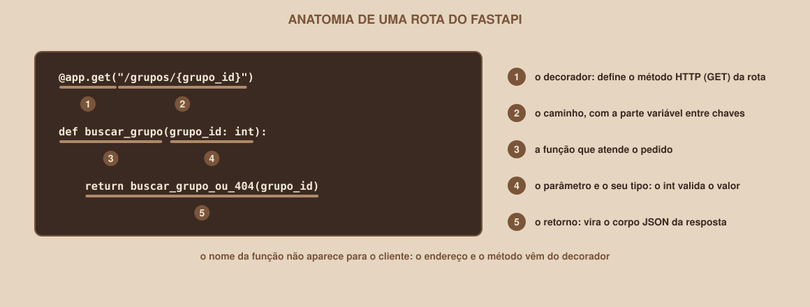

# Módulo 07, Sua Primeira API com FastAPI

`SEM 05 // API RESTful Central`

---

## // Antes de começar

Chegou a hora de ver uma API responder. Neste módulo você instala o FastAPI, escreve duas rotas, liga o servidor e abre o Swagger, a documentação interativa que o próprio FastAPI gera. Tenha à mão o ambiente virtual do Módulo 05, **ativado**.

> **VERSÕES E DATA DE CONSULTA**
> Este material foi verificado executando **FastAPI 0.143.0**, **Pydantic 2.13.5**, **Starlette 1.7.0**, **Uvicorn 0.54.0** e **Python 3.12.3**. A documentação oficial do FastAPI foi consultada em **08/10/2026**. O FastAPI é uma biblioteca de versão `0.x` e muda com frequência (por exemplo, o `Content-Type` estrito, a constante do 422 e o aviso do `httpx2` são mudanças recentes). Se algo divergir do que está aqui, a documentação oficial é a referência.

## // O problema: construir um servidor web do zero é trabalhoso

Receber conexões, entender o HTTP, converter JSON, validar dados e gerar mensagens de erro são tarefas repetitivas, e errar qualquer uma gera falhas de segurança. Um framework faz tudo isso pela pessoa, e deixa para ela só o que é específico do sistema.

## // O que é o FastAPI

> **FASTAPI: EM PALAVRAS SIMPLES**
> É um framework (um conjunto de ferramentas prontas) para construir APIs em Python. Ele lê as **dicas de tipo** do seu código para validar automaticamente os dados que chegam, e gera sozinho uma documentação interativa da API.

Três características explicam a popularidade dele: é rápido de escrever, valida os dados sem código extra, e a documentação nunca fica desatualizada, porque nasce do próprio código.

## // Instalando

Com o ambiente virtual ativo, crie na pasta `api-grupos` o arquivo `requirements.txt`, com uma linha:

```
fastapi[standard]>=0.143,<0.144
```

E instale:

```
pip install -r requirements.txt
```

Dois detalhes que merecem explicação:

- O trecho `[standard]` pede o pacote completo: o FastAPI junto com o servidor `uvicorn` e a ferramenta de linha de comando `fastapi`. Sem ele, você teria só a biblioteca.
- A faixa `>=0.143,<0.144` **fixa a versão**. O FastAPI ainda é uma biblioteca de versão `0.x`, e versões novas podem mudar comportamentos. Os exemplos desta semana foram executados na 0.143.

Confira a instalação:

```
fastapi --version
```

```
FastAPI CLI version: 0.0.32
FastAPI Cloud CLI version: 0.26.0
```

> **SE O TERMINAL RECLAMAR DOS COLCHETES**
> Em alguns terminais, como o `zsh` (o padrão do macOS), um comando digitado como `pip install fastapi[standard]` falha por causa dos colchetes. Por isso o `requirements.txt` é o caminho mais seguro: o arquivo não sofre esse problema. Se for digitar o comando direto, coloque o pacote entre aspas.

## // A primeira API

Crie o arquivo `main.py` na pasta `api-grupos`:

```python
from fastapi import FastAPI

app = FastAPI()


@app.get("/")
def raiz():
    return {"mensagem": "Olá, API!"}


@app.get("/status")
def status_da_api():
    return {"status": "no ar"}
```

Cinco linhas de lógica, e já é uma API completa. O que cada parte faz:

<div align="center">

</div>

| Parte | O que faz |
|---|---|
| `app = FastAPI()` | Cria a aplicação. O nome `app` é uma convenção |
| `@app.get("/")` | O **decorador**: diz que a função logo abaixo atende pedidos `GET` ao caminho `/` |
| `def raiz():` | A função que é executada quando o pedido chega |
| `return {...}` | O que a função devolve. O FastAPI converte o dicionário em JSON |

Uma função com um decorador forma uma **rota**. O nome da função (`raiz`) não aparece para o cliente: o que importa é o método e o caminho do decorador.

## // Ligando o servidor

Na pasta do projeto, com o ambiente ativo:

```
fastapi dev main.py
```

O terminal mostra algo como isto (o começo da saída; os ícones que o programa desenha foram omitidos aqui):

```
Starting FastAPI in development mode

Using import string: main:app

Server started at http://127.0.0.1:8000
Documentation at http://127.0.0.1:8000/docs

Logs:

INFO:     Will watch for changes in these directories: ['/caminho/da/sua/pasta']
INFO:     Uvicorn running on http://127.0.0.1:8000 (Press CTRL+C to quit)
```

O próprio programa informa onde o servidor está (`http://127.0.0.1:8000`) e onde fica a documentação (`/docs`). O comando `fastapi dev` é o modo de **desenvolvimento**: ele recarrega o servidor sozinho toda vez que você salva o arquivo. Para parar o servidor, pressione **Ctrl+C** no terminal.

> **FASTAPI DEV × FASTAPI RUN**
> Existe também o comando `fastapi run`, o modo de **produção**: ele não recarrega sozinho e anuncia o servidor em `http://0.0.0.0:...`. O endereço `0.0.0.0` significa "atender em todas as redes do computador", e não só nele mesmo, então **outros dispositivos da sua rede conseguem acessar a API**. Já o `fastapi dev` atende em `127.0.0.1`, que só o seu próprio computador alcança. Como a API desta semana não tem nenhum controle de acesso, use sempre `fastapi dev` enquanto estuda.

Abra `http://127.0.0.1:8000` no navegador. A resposta:

```
{"mensagem":"Olá, API!"}
```

E, no terminal, cada pedido que chega gera uma linha de registro:

```
INFO:     127.0.0.1:PORTA - "GET / HTTP/1.1" 200 OK
```

Essa linha reúne tudo o que você aprendeu no Módulo 02: o método (`GET`), o caminho (`/`), a versão do HTTP e o código de status (`200 OK`).

## // O Swagger: a documentação que você pode usar

Abra `http://127.0.0.1:8000/docs`. Esta página é o **Swagger UI**, gerada automaticamente a partir do seu código. Ela lista cada rota e permite **testá-la sem escrever nenhum cliente**:

1. Clique na linha da rota `GET /` para expandi-la.
2. Clique no botão **Try it out** (em inglês, o Swagger não está traduzido).
3. Clique em **Execute**.
4. Role até a seção **Server response**: ali aparecem o código (`200`), o corpo da resposta e os cabeçalhos.

> **O SWAGGER PRECISA DE INTERNET**
> O FastAPI monta a página `/docs` carregando os arquivos do Swagger UI de um endereço público de distribuição (`cdn.jsdelivr.net`). Se o seu computador estiver **sem conexão**, a API continua funcionando normalmente, mas a página `/docs` abre em branco. É o erro mais comum de quem estuda sem internet. Os passos acima foram descritos a partir da documentação do Swagger UI e da estrutura gerada pelo FastAPI; confira os nomes dos botões na sua tela.

Três endereços são gerados de graça pelo FastAPI:

| Endereço | O que é |
|---|---|
| `/docs` | O Swagger UI, interativo |
| `/redoc` | Uma documentação alternativa, só para leitura |
| `/openapi.json` | A descrição da API em um formato padronizado (OpenAPI), que as duas páginas anteriores leem |

## // Testando a segunda rota

Não é preciso acrescentar nada: a rota `/status` já está no arquivo. Chame `http://127.0.0.1:8000/status` no navegador:

```
{"status":"no ar"}
```

Agora modifique a mensagem de `raiz` para `"Olá, mundo!"`, salve o arquivo e recarregue a página. O terminal mostra que o servidor recarregou sozinho, e a resposta já vem com o texto novo.

## // Bom exemplo × mau exemplo

**Mau exemplo**: dar ao arquivo o nome de uma biblioteca:

```
fastapi.py
```

```
ImportError: cannot import name 'FastAPI' from partially initialized module 'fastapi' (most likely due to a circular import)
```

O Python procura primeiro na pasta atual. Se o seu arquivo se chama `fastapi.py`, ele tenta importar **a si mesmo** quando você escreve `from fastapi import FastAPI`.

**Bom exemplo**: um nome que não colide com nenhuma biblioteca:

```
main.py
```

Evite chamar os seus arquivos de `fastapi.py`, `pydantic.py`, `uvicorn.py` ou `random.py`.

## // Erros comuns

Todas as mensagens abaixo foram obtidas ao executar os comandos.

| Erro | O que diz | Por que acontece | Como corrigir |
|---|---|---|---|
| `fastapi: command not found` | `bash: line 1: fastapi: command not found` | O ambiente virtual não está ativo | Ative o ambiente (`(.venv)` no terminal) |
| Arquivo não encontrado | `Path does not exist nao_existe.py` | O nome do arquivo no comando está errado, ou você está na pasta errada | Confira o nome e rode o comando na pasta do arquivo |
| Porta ocupada | `ERROR:    [Errno 98] Address already in use` | Outro servidor já usa a porta 8000 | Pare o outro servidor, ou use `fastapi dev main.py --port 8001` |
| `ImportError ... partially initialized module 'fastapi'` | (veja o mau exemplo) | O arquivo tem o mesmo nome da biblioteca | Renomeie o arquivo |
| `/docs` abre em branco | (nenhuma mensagem de erro no terminal) | Sem internet para carregar os arquivos do Swagger | Conecte-se à internet e recarregue |
| Alterei o código e a resposta não mudou | (nenhuma mensagem) | O arquivo não foi salvo, ou o servidor foi iniciado sem o modo de desenvolvimento | Salve o arquivo e confirme que usou `fastapi dev` |

## // Prática guiada

1. Crie o `requirements.txt`, instale e rode `fastapi --version`.
2. Crie o `main.py` com as duas rotas e ligue o servidor.
3. Abra a rota `/` no navegador e confira a linha de registro no terminal.
4. Abra `/docs`, use **Try it out** e **Execute** na rota `/status`, e leia a seção de resposta.
5. Abra `/redoc` e `/openapi.json` e compare com o que você viu no `/docs`.

## // Pratique sozinho

> **DESAFIO**
> Acrescente uma terceira rota, `GET /sobre`, que devolva um dicionário com o nome da API e a versão (por exemplo, `{"api": "Buscador de Grupos de Estudo", "versao": "1.0.0"}`). Salve, recarregue, e confirme que ela apareceu sozinha no `/docs`, sem você escrever nenhuma documentação.

## // Aplicando no projeto da semana

1. Deixe o `main.py` com as rotas `/` e `/status`: ele será a base de tudo o que vem depois.
2. Confirme que o servidor liga com `fastapi dev main.py` e que o `/docs` abre.
3. Se você versiona o projeto com Git, faça um commit: `git commit -m "Primeira API com FastAPI"`.

## // Checkpoint

> **ANTES DE SEGUIR, PENSE NISTO**
> Você colocou `@app.get("/sobre")` em cima de uma função chamada `informacoes`. Qual é o endereço que o cliente usa para chamá-la, `/sobre` ou `/informacoes`?

Resposta: `/sobre`. O endereço e o método vêm do **decorador**, e o nome da função serve só para organizar o seu código (e para dar um nome à operação na documentação). O cliente nunca vê o nome `informacoes`.

## // Resumo do módulo

- [ ] Sei o que é o FastAPI e por que a versão é fixada no `requirements.txt`.
- [ ] Sei instalar o FastAPI e conferir a instalação.
- [ ] Sei escrever uma rota com decorador, função e retorno.
- [ ] Sei ligar o servidor com `fastapi dev` e pará-lo com Ctrl+C.
- [ ] Sei abrir o Swagger em `/docs` e executar uma rota por ele.
- [ ] Sei os erros mais comuns desta etapa e como resolvê-los.

---

**Próximo módulo:** `08-rotas-e-parametros.md`, as rotas desta etapa não recebem nada. A seguir, como receber valores pela URL, com validação automática.

`Material de Estudo // Coffee & Code`
