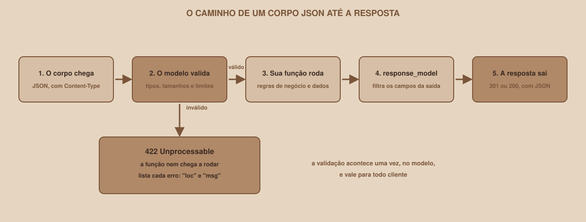

# Módulo 09, Modelos com Pydantic

`SEM 05 // API RESTful Central`

---

## // Antes de começar

Parâmetros de URL servem para valores simples, como um número ou uma palavra. Mas para criar um grupo é preciso enviar vários campos de uma vez, em JSON, no **corpo** da requisição. Este módulo apresenta o Pydantic, a biblioteca que o FastAPI usa para descrever e validar esses dados, e mostra como o FastAPI usa os modelos tanto na entrada quanto na saída.

## // O problema: dados que chegam de fora não são confiáveis

Qualquer pessoa pode enviar qualquer coisa: um nome vazio, um número onde se espera texto, um campo a mais ou a menos. Validar tudo isso à mão, campo por campo, gera dezenas de `if` repetidos, e basta um esquecido para o sistema aceitar dados inválidos. Um **modelo** descreve o formato esperado uma única vez, e a validação acontece sozinha.

## // O que é um modelo Pydantic

> **MODELO: EM PALAVRAS SIMPLES**
> É uma classe que descreve os campos de um dado, com o tipo e as regras de cada um. Ao criar um objeto a partir dela, o Pydantic confere tudo, converte o que for possível e recusa o que não servir.

```python
from pydantic import BaseModel, Field


class Grupo(BaseModel):
    nome_grupo: str = Field(min_length=3, max_length=60)
    materia_id: int = Field(gt=0)
    max_participantes: int = Field(default=10, ge=2, le=50)
    descricao: str | None = None
```

Cada linha dentro da classe declara um campo. O que significa cada parte:

| Parte | Significado |
|---|---|
| `nome_grupo: str` | O campo `nome_grupo` é um texto |
| `Field(min_length=3, max_length=60)` | O texto tem de 3 a 60 caracteres |
| `Field(gt=0)` | O número é **g**reater **t**han (maior que) 0 |
| `Field(default=10, ge=2, le=50)` | Vale 10 se não for informado, e deve estar entre 2 (**g**reater or **e**qual) e 50 (**l**ess or **e**qual) |
| `descricao: str \| None = None` | Opcional: pode ser texto ou `None`, e vale `None` por padrão |

## // O Pydantic em ação

```python
g = Grupo(nome_grupo="Modelagem e SQL", materia_id="3")
print(repr(g))
print(g.model_dump())
print(type(g.materia_id))
```

```
Grupo(nome_grupo='Modelagem e SQL', materia_id=3, max_participantes=10, descricao=None)
{'nome_grupo': 'Modelagem e SQL', 'materia_id': 3, 'max_participantes': 10, 'descricao': None}
<class 'int'>
```

Repare em três coisas. O `materia_id` chegou como o **texto** `"3"` e virou o **número** `3`: o Pydantic converte quando a conversão é segura. Os campos não informados receberam o valor padrão. E `.model_dump()` devolve o modelo de volta como um dicionário comum.

Agora, dados inválidos:

```python
Grupo(nome_grupo="ab", materia_id=0, max_participantes=99)
```

```
3 erros
   ('nome_grupo',) string_too_short | String should have at least 3 characters
   ('materia_id',) greater_than | Input should be greater than 0
   ('max_participantes',) less_than_equal | Input should be less than or equal to 50
```

O Pydantic não parou no primeiro problema: ele **reuniu os três erros** de uma vez, cada um com o campo e o motivo. É isso que vira a resposta `422` da API.

## // Modelos no corpo da requisição

No FastAPI, basta declarar um parâmetro do tipo do modelo, e ele passa a ser lido do **corpo JSON**:

```python
@app.post("/grupos")
def criar_grupo(novo: Grupo):
    return novo
```

O FastAPI faz, antes de chamar a sua função: lê o corpo, confere o `Content-Type`, converte o JSON, valida cada campo e, se tudo estiver certo, entrega o objeto pronto em `novo`. Se algo falhar, a sua função **nem chega a ser executada**: o cliente recebe o `422`.

<div align="center">

</div>

Um pedido real com o nome curto demais, e a resposta que o FastAPI produz sozinho:

```
POST /grupos   {"nome_grupo":"ab","materia_id":1}

422  {"detail":[{"type":"string_too_short","loc":["body","nome_grupo"],"msg":"String should have at least 3 characters","input":"ab","ctx":{"min_length":3}}]}
```

O campo `loc` agora começa por `body`, porque o problema está no corpo.

## // Vários modelos para um mesmo recurso

Na prática, um grupo aparece em formatos **ligeiramente diferentes** conforme a situação:

| Situação | O que muda | Modelo da API |
|---|---|---|
| Criar (`POST`) | A pessoa não envia o identificador nem a data: a API gera | `GrupoCreate` |
| Substituir (`PUT`) | Os campos obrigatórios são enviados de novo | `GrupoUpdate` |
| Alterar parte (`PATCH`) | Todos os campos são opcionais | `GrupoPatch` |
| Devolver ao cliente | Inclui o identificador e a data de criação | `GrupoOut` |

Para não repetir os campos quatro vezes, o código usa **herança**: um modelo base com os campos comuns, e os outros partindo dele:

```python
class GrupoBase(BaseModel):
    nome_grupo: str = Field(min_length=3, max_length=60)
    materia_id: int = Field(gt=0)
    max_participantes: int = Field(default=10, ge=2, le=50)
    descricao: str | None = Field(default=None, max_length=200)


class GrupoCreate(GrupoBase):
    """Corpo do POST: o que a pessoa envia para criar um grupo."""


class GrupoOut(GrupoBase):
    """O que a API devolve: os campos do grupo mais os que ela mesma gera."""

    grupo_id: int
    criado_em: datetime
```

`GrupoOut` herda os quatro campos do `GrupoBase` e acrescenta `grupo_id` e `criado_em`. O modelo completo do projeto, com os quatro, está no arquivo `schemas.py` da pasta `example/api-basica`.

## // response_model: o que sai também é validado

Na saída, o `response_model` funciona como um **filtro**. Ele garante que só os campos do modelo saiam, mesmo que a função devolva mais:

```python
class GrupoOut(BaseModel):
    grupo_id: int
    nome_grupo: str


@app.get("/interno", response_model=GrupoOut)
def interno():
    return {"grupo_id": 1, "nome_grupo": "Cálculo", "codigo_interno": "segredo-123"}
```

```
GET /interno

{"grupo_id":1,"nome_grupo":"Cálculo"}
```

O campo `codigo_interno` **não vazou**. Isso evita um erro clássico de segurança: devolver sem querer um dado que não devia sair, só porque ele estava no dicionário que a função montou.

## // PATCH e o model_dump

Para o `PATCH`, todos os campos do modelo são opcionais, e a função precisa saber **quais foram realmente enviados**. O `model_dump(exclude_unset=True)` devolve só esses:

```python
print(Grupo(nome_grupo="Redes na unha", materia_id=5).model_dump(exclude_unset=True))
```

```
{'nome_grupo': 'Redes na unha', 'materia_id': 5}
```

Os campos `max_participantes` e `descricao` ficaram de fora, porque a pessoa não os enviou. Sem o `exclude_unset`, eles viriam com o valor padrão e **sobrescreveriam** os dados do grupo sem que ninguém tivesse pedido.

### > Omitir não é o mesmo que enviar null

No `PATCH`, todos os campos são opcionais, e isso abre uma armadilha: o cliente pode **omitir** um campo (não quer alterá-lo) ou enviá-lo como `null`. São coisas diferentes. Para a `descricao`, o `null` faz sentido: significa "apagar a descrição". Mas para `nome_grupo`, `materia_id` e `max_participantes`, o `null` não faz sentido, e aceitá-lo **estraga os dados**.

Em um teste, uma versão sem proteção devolveu `500` para `{"nome_grupo": null}` e para `{"max_participantes": null}`. Pior: a alteração já tinha sido gravada em memória antes de o erro acontecer, então, dali em diante, até `GET /grupos` (a lista inteira) devolvia `500` para qualquer cliente, até o servidor reiniciar. Um único pedido ruim envenenava a API.

A proteção é um **validador** que recusa o `null` só nos três campos que não o aceitam:

```python
class GrupoPatch(BaseModel):
    nome_grupo: str | None = Field(default=None, min_length=3, max_length=60)
    materia_id: int | None = Field(default=None, gt=0)
    max_participantes: int | None = Field(default=None, ge=2, le=50)
    descricao: str | None = Field(default=None, max_length=200)

    @field_validator("nome_grupo", "materia_id", "max_participantes")
    @classmethod
    def nao_aceita_null(cls, valor):
        if valor is None:
            raise ValueError("este campo não aceita null: omita-o para não alterá-lo")
        return valor
```

O validador **não roda** para um campo omitido (o valor padrão não é validado), e roda só quando o cliente envia o campo de forma explícita. O resultado, com respostas reais:

```
PATCH /grupos/1   {"nome_grupo": null}

422  {"detail":[{"type":"value_error","loc":["body","nome_grupo"],"msg":"Value error, este campo não aceita null: omita-o para não alterá-lo","input":null,"ctx":{"error":{}}}]}

PATCH /grupos/1   {"descricao": null}     ->  200, a descrição é apagada
PATCH /grupos/1   {}                      ->  200, nada muda
```

## // Bom exemplo × mau exemplo

**Mau exemplo**: receber um dicionário solto e validar à mão:

```python
@app.post("/grupos")
def criar_grupo(novo: dict):
    if "nome_grupo" not in novo or len(novo["nome_grupo"]) < 3:
        return {"erro": "nome inválido"}
    ...
```

O dicionário aceita qualquer coisa, a validação cobre só um campo, o erro volta com `200`, e o Swagger não sabe descrever o formato do corpo.

**Bom exemplo**: um modelo que descreve o corpo:

```python
@app.post("/grupos")
def criar_grupo(novo: GrupoCreate):
    ...
```

A validação é completa e automática, o erro é um `422` detalhado, e o Swagger mostra o formato esperado e um exemplo preenchível.

## // Erros comuns

| Erro | Por que acontece | Como corrigir |
|---|---|---|
| `422` com `loc: ["body"]` e "Input should be a valid dictionary" | O corpo não chegou como JSON (falta o `Content-Type`), ou não é um objeto | Envie `Content-Type: application/json` e um objeto entre chaves |
| `422` com `json_invalid` e "JSON decode error" | O JSON está mal formado (aspas, vírgula, chave faltando) | Confira a sintaxe do JSON |
| Um campo obrigatório "some" da resposta | Ele não está no `response_model` | Declare todos os campos que devem sair |
| O `PATCH` apaga campos que não foram enviados | Faltou o `exclude_unset=True` | Use `model_dump(exclude_unset=True)` |
| Esquecer o `= None` em um campo opcional | Sem valor padrão, o campo vira obrigatório | Escreva `campo: str \| None = None` |
| Confundir `str` com `int` ao enviar JSON | `"3"` e `3` são coisas diferentes em JSON | O Pydantic converte quando é seguro, mas prefira enviar o tipo certo |

## // Prática guiada

1. Em um arquivo `modelos_teste.py`, crie o modelo `Grupo` desta seção e teste com `Grupo(nome_grupo="Modelagem e SQL", materia_id="3")`.
2. Provoque os três erros do exemplo, e leia as mensagens.
3. Teste `.model_dump()` e `.model_dump(exclude_unset=True)` com e sem o campo `max_participantes`.
4. No `main.py`, acrescente uma rota `POST /teste-grupo` que receba o modelo e o devolva. Teste pelo Swagger com um corpo válido e outro inválido.
5. Crie `GrupoOut` com um campo a menos que o dicionário devolvido, e confirme que o campo extra não vaza.

## // Pratique sozinho

> **DESAFIO**
> Crie um modelo `Livro` com `titulo` (texto de 1 a 100 caracteres), `ano` (inteiro entre 1450 e 2100) e `autor` (texto opcional). Crie uma rota `POST /livros` que receba o modelo e devolva o livro com um campo extra `id`, e use `response_model` para controlar a saída. Teste os valores limite do `ano` e um `titulo` vazio.

## // Aplicando no projeto da semana

1. Crie o arquivo `schemas.py` na pasta `api-grupos`, com os modelos `MateriaOut`, `GrupoBase`, `GrupoCreate`, `GrupoUpdate`, `GrupoPatch` e `GrupoOut`, do jeito que aparecem em `example/api-basica/schemas.py`.
2. Confira que o arquivo importa sem erro: `python -c "import schemas"`.
3. Se você versiona o projeto com Git, faça um commit: `git commit -m "Adiciona os modelos Pydantic da API"`.

## // Checkpoint

> **ANTES DE SEGUIR, PENSE NISTO**
> Por que o modelo `GrupoOut` tem os campos `grupo_id` e `criado_em`, mas o `GrupoCreate` não tem?

Resposta: porque quem **cria** o grupo não deve escolher o identificador nem a data: eles são responsabilidade da API, que garante que o identificador seja único e que a data seja a do momento real da criação. Se o `GrupoCreate` aceitasse esses campos, qualquer cliente poderia forjar um `grupo_id` já existente ou uma data falsa. Já o `GrupoOut` descreve o que a API **devolve**, e aí os dois campos fazem parte da resposta.

## // Resumo do módulo

- [ ] Sei criar um modelo com `BaseModel`, tipos e `Field`.
- [ ] Sei que o Pydantic converte tipos quando é seguro e reúne todos os erros de uma vez.
- [ ] Sei receber um corpo JSON declarando um parâmetro do tipo do modelo.
- [ ] Sei por que se usam modelos diferentes para criar, substituir, alterar e devolver.
- [ ] Sei usar herança para não repetir campos.
- [ ] Sei o que o `response_model` garante na saída.
- [ ] Sei usar `model_dump(exclude_unset=True)` para o `PATCH`.

---

**Próximo módulo:** `10-crud-lendo-dados.md`, com os modelos prontos, é hora de implementar de verdade as rotas do CRUD, começando pela leitura.

`Material de Estudo // Coffee & Code`
