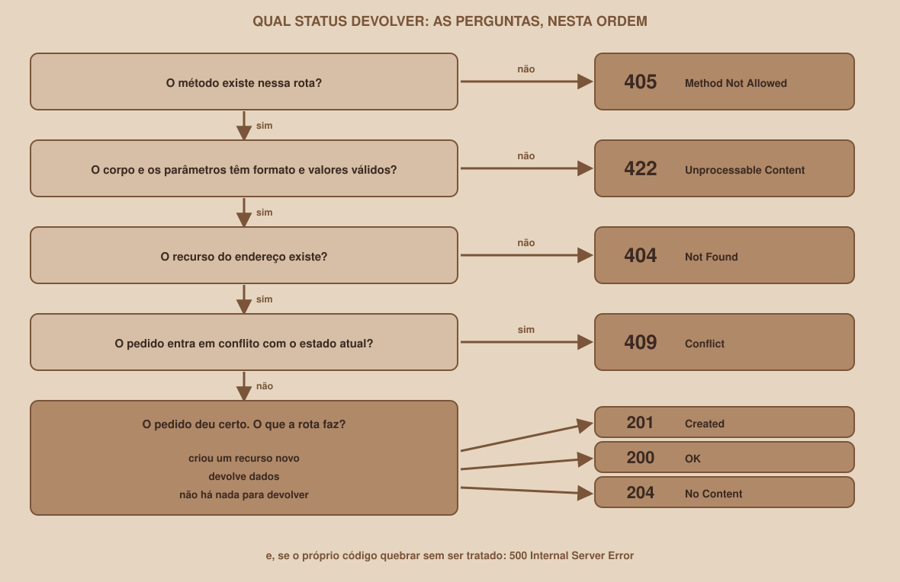

# Módulo 11, CRUD: Criar, Atualizar e Apagar

`SEM 05 // API RESTful Central`

---

## // Antes de começar

A leitura não altera nada, por isso é a parte mais simples do CRUD. Este módulo cobre as três letras que **mudam** os dados: **C**reate, **U**pdate e **D**elete. É aqui que os códigos `201`, `204` e `409` aparecem, e onde a escolha do método e do código mais importa.

## // O problema: alterar dados exige cuidado

Ler é inofensivo. Criar, trocar e apagar não são: um erro cria um grupo duplicado, apaga o grupo errado ou deixa dados quebrados. Por isso, cada uma dessas operações precisa **conferir** o que chegou antes de mexer, e **responder com precisão** o que aconteceu.

## // Regras do projeto

Antes do código, vale decidir as regras. A API do projeto segue estas:

| Regra | Se for violada |
|---|---|
| O `materia_id` precisa existir | `422` |
| Os campos precisam respeitar o modelo (nome de 3 a 60 caracteres, limite de 2 a 50) | `422` |
| Não pode haver dois grupos com o mesmo nome **na mesma matéria** (sem diferenciar maiúsculas) | `409` |
| O grupo a alterar ou apagar precisa existir | `404` |

Estas duas funções de apoio conferem as duas regras do meio e de fora do modelo:

```python
def conferir_materia(materia_id: int) -> None:
    if materia_id not in dados.MATERIAS:
        raise HTTPException(
            status_code=status.HTTP_422_UNPROCESSABLE_CONTENT,
            detail=f"A matéria {materia_id} não existe",
        )


def conferir_nome_livre(nome_grupo: str, materia_id: int, ignorar_id: int | None = None) -> None:
    for grupo in dados.GRUPOS.values():
        mesmo_nome = grupo["nome_grupo"].lower() == nome_grupo.lower()
        if mesmo_nome and grupo["materia_id"] == materia_id and grupo["grupo_id"] != ignorar_id:
            raise HTTPException(
                status_code=status.HTTP_409_CONFLICT,
                detail="Já existe um grupo com esse nome nessa matéria",
            )
```

O parâmetro `ignorar_id` existe para as rotas de alteração: um grupo pode manter o próprio nome, e só não pode ficar com o nome de **outro**.

## // Criar: POST e o 201

```python
@app.post("/grupos", response_model=GrupoOut, status_code=status.HTTP_201_CREATED)
def criar_grupo(novo: GrupoCreate, response: Response):
    conferir_materia(novo.materia_id)
    conferir_nome_livre(novo.nome_grupo, novo.materia_id)
    grupo_id = next(dados.CONTADOR_GRUPOS)
    grupo = {**novo.model_dump(), "grupo_id": grupo_id, "criado_em": datetime.now(timezone.utc)}
    dados.GRUPOS[grupo_id] = grupo
    response.headers["Location"] = f"/grupos/{grupo_id}"
    return grupo
```

Passo a passo:

1. `novo: GrupoCreate` lê e valida o corpo JSON (Módulo 09).
2. As duas conferências podem levantar `422` ou `409`.
3. `next(dados.CONTADOR_GRUPOS)` gera o próximo identificador (Módulo 06).
4. `{**novo.model_dump(), ...}` monta o dicionário do grupo juntando os campos enviados com os que a API gera. O `**` "espalha" o conteúdo de um dicionário dentro de outro.
5. O grupo é guardado em `dados.GRUPOS`.
6. O cabeçalho `Location` informa o endereço do grupo novo.
7. `status_code=201` no decorador define o código de **sucesso** da rota.

```
POST /grupos   {"nome_grupo":"Cálculo II na prática","materia_id":1,"max_participantes":5}

201 Created
location: /grupos/7
{"nome_grupo":"Cálculo II na prática","materia_id":1,"max_participantes":5,"descricao":null,"grupo_id":7,"criado_em":"2026-10-08T12:52:39.463873Z"}
```

E os erros, todos obtidos da API em execução:

```
POST /grupos   (o mesmo corpo, de novo)
409  {"detail":"Já existe um grupo com esse nome nessa matéria"}

POST /grupos   {"nome_grupo":"Grupo fantasma","materia_id":99}
422  {"detail":"A matéria 99 não existe"}

POST /grupos   {"nome_grupo":"ab","materia_id":1}
422  {"detail":[{"type":"string_too_short","loc":["body","nome_grupo"], ... }]}
```

Duas observações sobre as regras: um mesmo nome **em outra matéria** é aceito (`201`), e a comparação ignora maiúsculas e minúsculas (criar `CÁLCULO PASSO A PASSO` na matéria 1 devolve `409`, porque `Cálculo passo a passo` já existe lá).

## // Substituir: PUT

O `PUT` troca o grupo **inteiro** (Módulo 03):

```python
@app.put("/grupos/{grupo_id}", response_model=GrupoOut)
def substituir_grupo(grupo_id: int, novo: GrupoUpdate):
    antigo = buscar_grupo_ou_404(grupo_id)
    conferir_materia(novo.materia_id)
    conferir_nome_livre(novo.nome_grupo, novo.materia_id, ignorar_id=grupo_id)
    grupo = {**novo.model_dump(), "grupo_id": grupo_id, "criado_em": antigo["criado_em"]}
    dados.GRUPOS[grupo_id] = grupo
    return grupo
```

O identificador e a data de criação **não mudam**: eles vêm do grupo antigo. Todo o resto vem do corpo.

```
PUT /grupos/7   {"nome_grupo":"Cálculo II revisado","materia_id":1,"max_participantes":6}

200  {"nome_grupo":"Cálculo II revisado","materia_id":1,"max_participantes":6,"descricao":null,"grupo_id":7,"criado_em":"2026-10-08T12:52:39.463873Z"}
```

Se o `PUT` omitir um campo opcional, ele **volta ao valor padrão**. Enviar só `nome_grupo` e `materia_id` faz o `max_participantes` voltar a 10 e a `descricao` ficar `null`.

## // Alterar parte: PATCH

O `PATCH` muda só o que foi enviado:

```python
@app.patch("/grupos/{grupo_id}", response_model=GrupoOut)
def alterar_grupo(grupo_id: int, mudancas: GrupoPatch):
    grupo = buscar_grupo_ou_404(grupo_id)
    campos = mudancas.model_dump(exclude_unset=True)
    if "materia_id" in campos:
        conferir_materia(campos["materia_id"])
    nome = campos.get("nome_grupo", grupo["nome_grupo"])
    materia = campos.get("materia_id", grupo["materia_id"])
    conferir_nome_livre(nome, materia, ignorar_id=grupo_id)
    grupo.update(campos)
    return grupo
```

O `exclude_unset=True` (Módulo 09) garante que só os campos enviados entrem em `campos`. O `grupo.update(campos)` sobrescreve só essas chaves do dicionário. As linhas do `nome` e da `materia` calculam o **resultado final** (o que vai ficar depois da alteração), para conferir se ele não colide com outro grupo.

```
PATCH /grupos/7   {"max_participantes":8}

200  {"nome_grupo":"Cálculo II revisado","materia_id":1,"max_participantes":8,"descricao":null,"grupo_id":7,"criado_em":"2026-10-08T12:52:39.463873Z"}
```

Só o `max_participantes` mudou, de 6 para 8.

> **VALIDAR ANTES DE ALTERAR**
> A ordem das linhas do `PATCH` importa: primeiro **todas as conferências** (matéria existe, nome livre), e só no fim o `grupo.update(campos)`. Se a alteração acontecesse antes de uma conferência falhar, o grupo ficaria meio alterado. O mesmo cuidado vale para os valores `null`: o modelo `GrupoPatch` do Módulo 09 recusa `null` em `nome_grupo`, `materia_id` e `max_participantes` com um `422`, justamente para que um valor inválido nunca chegue à parte que grava. Sem essa proteção, um único `PATCH` com `{"max_participantes": null}` corrompia o grupo e fazia a lista inteira devolver `500`.

## // Apagar: DELETE e o 204

```python
@app.delete("/grupos/{grupo_id}", status_code=status.HTTP_204_NO_CONTENT)
def apagar_grupo(grupo_id: int):
    buscar_grupo_ou_404(grupo_id)
    del dados.GRUPOS[grupo_id]
```

Repare que a função **não devolve nada**: o `204` significa "deu certo, e não há conteúdo". Confira a resposta completa e a segunda tentativa:

```
DELETE /grupos/7

HTTP/1.1 204 No Content
(sem corpo)

DELETE /grupos/7   (de novo)

HTTP/1.1 404 Not Found
{"detail":"Grupo não encontrado"}
```

É a idempotência do Módulo 03 na prática: a segunda chamada devolve um código diferente, mas o estado final é o mesmo (o grupo 7 não existe).

> **O 204 NÃO LEVA CORPO**
> O código `204` significa "sem conteúdo", e o corpo da resposta fica vazio. Nos testes desta semana, mesmo uma função que devolvia um dicionário em uma rota declarada com `204` não enviou corpo nenhum: o FastAPI o descartou. Mesmo assim, deixe a função terminar **sem** `return`: o código fica mais honesto, e quem lê entende que a rota realmente não devolve nada.

## // Qual código devolver: o mapa do CRUD

<div align="center">

</div>

| Operação | Sucesso | Erros possíveis |
|---|---|---|
| `GET /grupos` | `200` | `422` (parâmetro inválido) |
| `GET /grupos/{id}` | `200` | `404`, `422` |
| `POST /grupos` | `201` | `409`, `422` |
| `PUT /grupos/{id}` | `200` | `404`, `409`, `422` |
| `PATCH /grupos/{id}` | `200` | `404`, `409`, `422` |
| `DELETE /grupos/{id}` | `204` | `404`, `422` |

## // Um detalhe sobre curl e o JSON

Ao testar pelo `curl` (Módulo 02), lembre do `-H "Content-Type: application/json"` em todo `POST`, `PUT` e `PATCH`. Sem ele, qualquer um dos três devolve o `422` de "Input should be a valid dictionary". O Swagger envia o cabeçalho certo sozinho.

## // Bom exemplo × mau exemplo

**Mau exemplo**: criar sem conferir nada:

```python
@app.post("/grupos")
def criar_grupo(novo: GrupoCreate):
    dados.GRUPOS[len(dados.GRUPOS) + 1] = novo.model_dump()
    return "ok"
```

Este código usa o tamanho do dicionário como identificador (se um grupo for apagado, ele **reaproveita** um número ou sobrescreve outro grupo), ignora a matéria e a duplicidade, não gera `criado_em`, e devolve um texto solto com `200`.

**Bom exemplo**: conferir, gerar o identificador de forma segura e responder bem:

```python
@app.post("/grupos", response_model=GrupoOut, status_code=status.HTTP_201_CREATED)
def criar_grupo(novo: GrupoCreate, response: Response):
    conferir_materia(novo.materia_id)
    conferir_nome_livre(novo.nome_grupo, novo.materia_id)
    grupo_id = next(dados.CONTADOR_GRUPOS)
    ...
```

## // Erros comuns

| Erro | Por que acontece | Como corrigir |
|---|---|---|
| A rota devolve `200` ao criar | Faltou `status_code=201` no decorador | Acrescente `status_code=status.HTTP_201_CREATED` |
| O `DELETE` devolve `200` com `null` | Faltou `status_code=204` no decorador | Acrescente `status_code=status.HTTP_204_NO_CONTENT` |
| O `PATCH` apaga campos que não foram enviados | Faltou `exclude_unset=True` | Use `model_dump(exclude_unset=True)` |
| O `PATCH` com `null` devolve `500` e estraga os dados | O modelo aceita `null` em um campo que não pode ficar vazio | Valide com `field_validator` (Módulo 09) |
| O `PUT` e o `PATCH` devolvem `409` ao manter o próprio nome | A checagem de duplicidade não ignora o próprio grupo | Passe `ignorar_id=grupo_id` |
| Dois grupos recebem o mesmo identificador | O identificador foi calculado com `len(...)` | Use um contador (`next`) que nunca volta atrás |
| `422` ao enviar JSON pelo `curl` | Faltou o `Content-Type` | Acrescente `-H "Content-Type: application/json"` |
| Os dados sumiram | O servidor foi reiniciado | É o esperado: os dados vivem em memória |

## // Prática guiada

1. Escreva as funções `conferir_materia` e `conferir_nome_livre` no `main.py`.
2. Escreva a rota `POST /grupos`. Pelo Swagger, crie um grupo, depois repita para obter o `409`, depois tente um `materia_id` inexistente e um nome curto demais.
3. Escreva `PUT` e `PATCH`. Teste um `PUT` com só os campos obrigatórios e veja o `max_participantes` voltar a 10.
4. Escreva o `DELETE`. Apague um grupo duas vezes seguidas e compare as respostas.
5. Confira, no `GET /grupos`, que a lista reflete cada mudança.

## // Pratique sozinho

> **DESAFIO**
> Acrescente ao `POST /grupos` uma regra que o modelo não cobre: o nome do grupo **não pode ser formado só por números** (como `"12345"`). Use o método `isdigit()` dos textos, e devolva `422` com a mensagem "O nome do grupo não pode ser só números". Teste com `"12345"` e com `"Grupo 12345"` (este último deve ser aceito).

## // Aplicando no projeto da semana

1. Complete o `main.py` com as rotas `POST`, `PUT`, `PATCH` e `DELETE`.
2. No `README.md`, preencha a tabela de códigos do mapa do CRUD com o que você de fato obteve ao testar cada operação.
3. Se você versiona o projeto com Git, faça um commit: `git commit -m "Implementa criar, atualizar e apagar grupos"`.

## // Checkpoint

> **ANTES DE SEGUIR, PENSE NISTO**
> Um `PUT /grupos/7` chega com um corpo que usa o nome de **outro** grupo da mesma matéria. Que código deve ser devolvido, e por que não é um `422`?

Resposta: `409 Conflict`. O corpo está **bem formado**: todos os campos têm o tipo e o tamanho corretos, então a validação do modelo passa. O problema é que o resultado entraria em **conflito com o estado atual** do sistema (já existe um grupo com esse nome naquela matéria). O `422` é para dados mal formados ou que violam as regras do próprio formato, e o `409` é para um pedido válido que não pode ser aceito agora.

## // Resumo do módulo

- [ ] Sei implementar `POST` devolvendo `201` e o cabeçalho `Location`.
- [ ] Sei implementar `PUT` (substituir) e `PATCH` (alterar parte).
- [ ] Sei implementar `DELETE` devolvendo `204` sem corpo.
- [ ] Sei aplicar regras de negócio com `422` e `409`.
- [ ] Sei por que o identificador vem de um contador, e não de `len(...)`.
- [ ] Sei o código de sucesso e os erros possíveis de cada rota.

---

**Próximo módulo:** `12-swagger-na-pratica.md`, a API está completa. Falta aprender a documentá-la e a usar o Swagger como ferramenta de teste de verdade.

`Material de Estudo // Coffee & Code`
