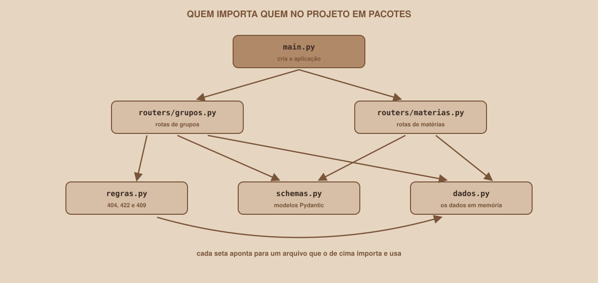
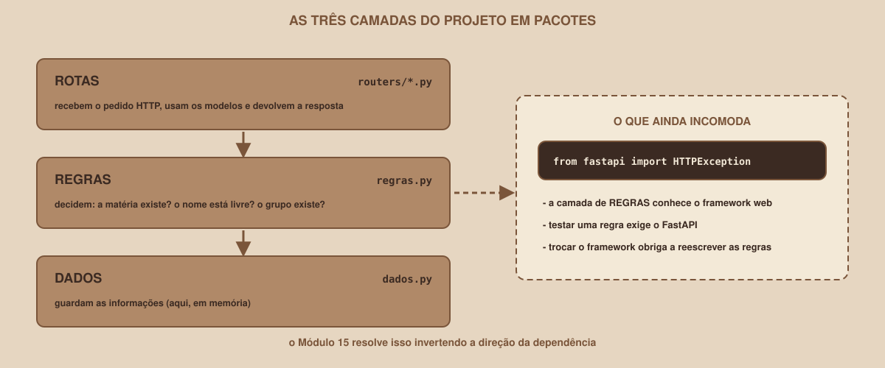

# Módulo 14, Organizando uma API em Camadas

Português · [English](../docs-eng/14-organizing-an-api-in-layers.md)

`SEM 05 // API RESTful Central`

---

## // Antes de começar

> **TRILHA VETERANO**
> Este módulo faz parte da trilha veterano: ele vem depois do conteúdo essencial e não é necessário para o entregável da semana. Quem segue a trilha principal pode pular para o `entregavel.md`.

A API da trilha principal cabe em um único `main.py`, e isso é ótimo para aprender. Mas um arquivo com todas as rotas, todas as regras e todos os dados deixa de ser viável quando a API cresce. Este módulo divide a API em **pacotes e camadas**, sem mudar nenhuma resposta dela, e termina mostrando um problema que a divisão sozinha não resolve. O Módulo 15 resolve esse problema.

## // O problema: um arquivo que faz tudo

Um `main.py` com 300 linhas mistura a criação da aplicação, as rotas de grupos, as rotas de matérias e as regras de negócio. Achar onde mudar uma regra exige rolar o arquivo inteiro, e uma alteração em uma rota arrisca quebrar outra. A solução é dar a cada responsabilidade o seu próprio arquivo.

## // Pacote e APIRouter

> **PACOTE: EM PALAVRAS SIMPLES**
> É uma pasta de arquivos Python que pode ser importada como um conjunto. O arquivo `__init__.py` (que pode ficar vazio) é o que diz ao Python que a pasta é um pacote.

> **APIROUTER: EM PALAVRAS SIMPLES**
> É um objeto que agrupa as rotas de um recurso, como se fosse uma "mini-aplicação". Ele é criado em um arquivo próprio, e depois ligado à aplicação principal.

A estrutura da versão em pacotes (`example/api-em-pacotes/`):

```
api-em-pacotes/
├── app/
│   ├── __init__.py
│   ├── main.py
│   ├── dados.py
│   ├── schemas.py
│   ├── regras.py
│   └── routers/
│       ├── __init__.py
│       ├── grupos.py
│       └── materias.py
└── requirements.txt
```

| Arquivo | Responsabilidade |
|---|---|
| `main.py` | Cria a aplicação e liga os routers. Quase não tem lógica |
| `routers/grupos.py` e `routers/materias.py` | Só as rotas de cada recurso |
| `regras.py` | As regras de negócio reutilizadas (404, 422 e 409) |
| `schemas.py` | Os modelos Pydantic |
| `dados.py` | Os dados em memória |

<div align="center">

</div>

O começo do `routers/grupos.py`:

```python
from fastapi import APIRouter, Response, status

from app import dados, regras
from app.schemas import GrupoCreate, GrupoOut, GrupoPatch, GrupoUpdate

router = APIRouter(prefix="/grupos", tags=["grupos"])


@router.get("", response_model=list[GrupoOut], summary="Lista os grupos")
def listar_grupos(q: str | None = None, materia_id: int | None = None):
    ...
```

Duas mudanças em relação ao `main.py` da trilha principal:

- O decorador deixou de ser `@app.get(...)` e passou a ser `@router.get(...)`.
- O `prefix="/grupos"` e o `tags=["grupos"]` são definidos **uma vez**, no router. Por isso a rota de listar usa o caminho `""` (vazio): o endereço final é o prefixo mais o caminho. A rota de buscar um item usa `"/{grupo_id}"`, e o endereço final é `/grupos/{grupo_id}`.

E o `main.py` fica pequeno, só liga as peças:

```python
from fastapi import FastAPI

from app.routers import grupos, materias

app = FastAPI(title="API Central: Buscador de Grupos de Estudo", description=DESCRICAO, version="1.1.0", openapi_tags=[...])

app.include_router(materias.router)
app.include_router(grupos.router)
```

## // Imports absolutos

Dentro de um pacote, os imports começam pelo nome do pacote:

```python
from app import dados, regras
from app.schemas import GrupoCreate
```

Esse é o motivo de a pasta se chamar `app`: ela é o ponto de partida de todos os imports.

## // Rodando o projeto em pacotes

O comando muda só o caminho do arquivo. Na pasta `api-em-pacotes`:

```
fastapi dev app/main.py
```

```
Using import string: app.main:app

Server started at http://127.0.0.1:8000
Documentation at http://127.0.0.1:8000/docs
```

Repare em `app.main:app`: é o caminho do pacote (`app.main`) e o nome do objeto (`app`). A documentação do FastAPI descreve também uma forma de registrar esse caminho no arquivo de configuração do projeto (`[tool.fastapi]` com `entrypoint`), para que baste digitar `fastapi dev`; essa opção não foi testada aqui.

## // As três camadas

<div align="center">

</div>

A divisão cria, na prática, **camadas**, e cada uma tem um papel:

| Camada | Arquivo | O que decide |
|---|---|---|
| **Rotas** | `routers/*.py` | Como o pedido HTTP chega e como a resposta sai |
| **Regras** | `regras.py` | O que o sistema permite: a matéria existe? o nome está livre? o grupo existe? |
| **Dados** | `dados.py` | Onde as informações ficam guardadas |

Uma regra de ouro das camadas: **cada uma só deve falar com a que está logo abaixo**. A rota chama a regra, e a regra consulta os dados. Nunca o contrário.

### > O que não muda

Dividir é uma mudança de **organização**, e não de comportamento. A prova, nesta versão: o `/openapi.json` lista os mesmos quatro caminhos (`/materias`, `/materias/{materia_id}`, `/grupos` e `/grupos/{grupo_id}`) com os mesmos métodos, e as requisições do roteiro do Módulo 13 devolvem os mesmos códigos.

## // O que ainda incomoda

Abra o `regras.py`:

```python
from fastapi import HTTPException, status

from app import dados


def buscar_grupo_ou_404(grupo_id: int) -> dict:
    grupo = dados.GRUPOS.get(grupo_id)
    if grupo is None:
        raise HTTPException(status_code=status.HTTP_404_NOT_FOUND, detail="Grupo não encontrado")
    return grupo
```

Repare na primeira linha: `from fastapi import HTTPException`. A camada de **regras**, que deveria saber só do sistema de grupos, importou o framework web. Três consequências:

- **Testar uma regra exige o FastAPI.** Para conferir que "grupo inexistente" é um erro, é preciso lidar com `HTTPException` e com códigos de status, que são assunto de HTTP, e não da regra.
- **A regra conhece o código de status.** Quem decide que "não encontrado" é `404` deveria ser a camada de rotas, a única que fala HTTP.
- **Trocar o framework obriga a reescrever as regras.** Se um dia a mesma regra precisar servir a outro tipo de programa (um script de terminal, por exemplo), ela vem "contaminada" por HTTP.

A divisão em arquivos organizou o código, mas **não inverteu a dependência**: as regras ainda dependem do framework. O Módulo 15 mostra como virar esse jogo.

## // Bom exemplo × mau exemplo

**Mau exemplo**: copiar as regras para dentro de cada router:

```python
# em routers/grupos.py
def conferir_materia(materia_id): ...

# em routers/outro.py
def conferir_materia(materia_id): ...   # uma cópia, que um dia ficará diferente
```

Duas cópias da mesma regra acabam diferentes: alguém corrige uma e esquece a outra.

**Bom exemplo**: uma única definição em `regras.py`, importada por quem precisa:

```python
from app import regras

regras.conferir_materia(novo.materia_id)
```

## // Erros comuns

Estas mensagens foram obtidas ao executar o código.

| Erro | O que diz | Por que acontece | Como corrigir |
|---|---|---|---|
| `ModuleNotFoundError` | `No module named 'dados'` | Um import dentro do pacote ficou como `import dados` | Use `from app import dados` |
| `ModuleNotFoundError` | `No module named 'app'` | O comando foi executado fora da pasta que contém `app` | Entre na pasta do projeto antes de rodar |
| Um import falha de forma estranha | (varia) | Falta o `__init__.py` em uma das pastas | Crie o arquivo vazio em `app` e em `app/routers` |
| As rotas de um router não aparecem no `/docs` | (nenhuma mensagem) | Faltou o `app.include_router(...)` | Ligue cada router no `main.py` |
| O endereço final ficou `/grupos/grupos` | (nenhuma mensagem) | O prefixo foi repetido no decorador e no router | Defina o prefixo só no `APIRouter` |

## // Prática guiada

1. Crie a pasta `api-em-pacotes`, com `app` e `app/routers`, e os dois `__init__.py` vazios.
2. Mova os modelos para `app/schemas.py`, os dados para `app/dados.py` e as três funções de regra para `app/regras.py`.
3. Crie `app/routers/materias.py` e `app/routers/grupos.py` com `APIRouter` e passe para eles as rotas do `main.py`.
4. Reescreva o `app/main.py` só com a criação da aplicação e os dois `include_router`.
5. Rode `fastapi dev app/main.py`, abra o `/docs` e confira que todas as rotas continuam lá.

## // Pratique sozinho

> **DESAFIO**
> Crie um terceiro router, `routers/saude.py`, com uma única rota `GET /saude` que devolva `{"status": "ok"}`. Use o prefixo e as tags do `APIRouter`, ligue-o no `main.py` e confirme que ele aparece no `/docs` em um grupo próprio. Depois, procure no seu código **todos** os arquivos que importam algo do `fastapi` e anote quais deles não são rotas: é a lista do que o Módulo 15 vai limpar.

## // Aplicando no projeto da semana

1. Se você seguiu a trilha veterano, mantenha a versão em pacotes em uma pasta separada, sem apagar a `api-grupos` da trilha principal.
2. Confira que o `/openapi.json` das duas versões lista os mesmos caminhos.
3. Se você versiona o projeto com Git, faça um commit: `git commit -m "Divide a API em pacotes e routers"`.

## // Checkpoint

> **ANTES DE SEGUIR, PENSE NISTO**
> Você moveu as rotas de grupos para um router com `prefix="/grupos"`, mas manteve o caminho `"/grupos"` no decorador de listar. Qual será o endereço da rota, e como corrigir?

Resposta: o endereço final será `/grupos/grupos`, porque o prefixo do router é somado ao caminho do decorador. A correção é usar o caminho vazio (`@router.get("")`) para a rota de listar, e `"/{grupo_id}"` para as de um item, deixando o `/grupos` só no `prefix`.

## // Resumo do módulo

- [ ] Sei dividir a API em um pacote, com `__init__.py` e imports absolutos.
- [ ] Sei criar um `APIRouter` com prefixo e tags, e ligá-lo com `include_router`.
- [ ] Sei descrever as três camadas (rotas, regras e dados) e o papel de cada uma.
- [ ] Sei rodar um projeto em pacote com `fastapi dev app/main.py`.
- [ ] Sei explicar por que `from fastapi import HTTPException` dentro das regras é um problema.

---

**Próximo módulo:** `15-clean-architecture-no-fastapi.md`: as camadas existem, mas a dependência ainda aponta para o lado errado. Hora de invertê-la.

`Material de Estudo // Coffee & Code`
