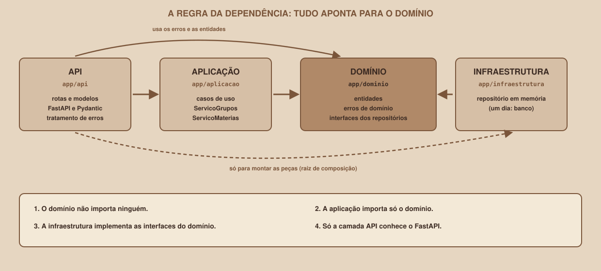

# Módulo 15, Clean Architecture no FastAPI

Português · [English](../docs-eng/15-clean-architecture-in-fastapi.md)

`SEM 05 // API RESTful Central`

---

## // Antes de começar

> **TRILHA VETERANO**
> Este módulo faz parte da trilha veterano: ele vem depois do conteúdo essencial e não é necessário para o entregável da semana. Quem segue a trilha principal pode pular para o `entregavel.md`.

O Módulo 14 deixou uma pergunta: como fazer a camada de **regras** deixar de conhecer o FastAPI? Este módulo responde com a **Clean Architecture** (arquitetura limpa): uma forma de organizar o código para que o coração do sistema, as regras, não dependa de nenhuma tecnologia. A API completa, testada, está em `example/api-limpa/`.

## // O problema: regras presas ao framework

No Módulo 14, a regra "grupo não encontrado" levantava um `HTTPException(404)`. Isso mistura duas ideias que não são a mesma coisa: **o que deu errado** (o grupo não existe) e **como contar isso ao cliente** (um código `404` em HTTP). A primeira ideia pertence ao sistema. A segunda pertence à camada web. Quando as duas moram no mesmo lugar, mudar uma exige mexer na outra.

## // O que é Clean Architecture

> **CLEAN ARCHITECTURE: EM PALAVRAS SIMPLES**
> É um jeito de organizar o código em camadas em que **as dependências apontam sempre para dentro**: as camadas externas (web, banco de dados) conhecem as internas (as regras do sistema), mas as internas **não conhecem** as externas. O núcleo não sabe que o FastAPI existe.

<div align="center">

</div>

O projeto passa a ter quatro camadas:

| Camada | Pasta | O que contém | Pode importar |
|---|---|---|---|
| **Domínio** | `app/dominio` | Entidades, erros de domínio e as **interfaces** dos repositórios | Só a biblioteca padrão do Python |
| **Aplicação** | `app/aplicacao` | Os casos de uso (`ServicoGrupos`, `ServicoMaterias`) | O domínio |
| **Infraestrutura** | `app/infraestrutura` | O repositório em memória | O domínio |
| **API** | `app/api` | Rotas, modelos Pydantic, tratamento de erros | A aplicação e o domínio. Só ela conhece o FastAPI |

> **A REGRA DA DEPENDÊNCIA**
> Um arquivo de uma camada só pode importar de camadas **mais internas**. O domínio não importa ninguém. É essa regra que mantém o núcleo livre de frameworks.

A estrutura completa:

```
api-limpa/
├── app/
│   ├── main.py
│   ├── dominio/
│   │   ├── entidades.py
│   │   ├── erros.py
│   │   └── repositorios.py
│   ├── aplicacao/
│   │   └── servicos.py
│   ├── infraestrutura/
│   │   └── memoria.py
│   └── api/
│       ├── schemas.py
│       ├── dependencias.py
│       ├── erros.py
│       └── routers/
│           ├── grupos.py
│           └── materias.py
├── tests/
├── pytest.ini
└── requirements.txt
```

## // Domínio: entidades e erros

As entidades são classes simples, com os dados do conceito e nada mais. Aqui, `@dataclass` (da biblioteca padrão) gera o construtor automaticamente:

```python
from dataclasses import dataclass
from datetime import datetime


@dataclass
class Grupo:
    grupo_id: int | None  # None enquanto o grupo ainda não foi guardado
    nome_grupo: str
    materia_id: int
    max_participantes: int
    descricao: str | None
    criado_em: datetime
```

Os erros do domínio dizem **o que deu errado**, sem uma palavra sobre HTTP:

```python
class ErroDeDominio(Exception):
    """Base de todos os erros de regra de negócio."""

    codigo = "erro_de_dominio"

    def __init__(self, mensagem: str):
        super().__init__(mensagem)
        self.mensagem = mensagem


class GrupoNaoEncontradoError(ErroDeDominio):
    codigo = "grupo_nao_encontrado"

    def __init__(self):
        super().__init__("Grupo não encontrado")
```

Repare: nenhum `404`, nenhum JSON, nenhum `fastapi`. A regra agora levanta `GrupoNaoEncontradoError()`, e quem transforma isso em `404` é outra camada (o Módulo 16 mostra como).

## // A interface do repositório

Como a aplicação guarda e busca grupos sem saber **onde** eles ficam? Pela **interface** de um repositório, definida no próprio domínio:

```python
from typing import Protocol

from app.dominio.entidades import Grupo


class RepositorioGrupos(Protocol):
    def listar(self) -> list[Grupo]: ...

    def buscar(self, grupo_id: int) -> Grupo | None: ...

    def salvar(self, grupo: Grupo) -> Grupo:
        """Guarda o grupo. Se ele ainda não tem identificador, cria um."""
        ...

    def apagar(self, grupo_id: int) -> None: ...
```

> **PROTOCOL: EM PALAVRAS SIMPLES**
> É uma forma de dizer "qualquer classe que tenha estes métodos serve", sem exigir que ela herde de nada. A interface descreve o **que** o núcleo precisa, e quem implementa decide **como**.

A interface fica no **domínio**, e a implementação fica na **infraestrutura**. É isso que inverte a dependência: o núcleo dita o contrato, e o detalhe se encaixa nele.

## // Aplicação: os casos de uso

O serviço recebe os repositórios pelo construtor, e só conhece as interfaces:

```python
class ServicoGrupos:
    def __init__(self, grupos: RepositorioGrupos, materias: RepositorioMaterias):
        self._grupos = grupos
        self._materias = materias

    def buscar(self, grupo_id: int) -> Grupo:
        grupo = self._grupos.buscar(grupo_id)
        if grupo is None:
            raise GrupoNaoEncontradoError()
        return grupo

    def criar(self, nome_grupo: str, materia_id: int, max_participantes: int = 10, descricao: str | None = None) -> Grupo:
        self._conferir_materia(materia_id)
        self._conferir_nome_livre(nome_grupo, materia_id)
        novo = Grupo(None, nome_grupo, materia_id, max_participantes, descricao, datetime.now(timezone.utc))
        return self._grupos.salvar(novo)
```

O serviço não importa nada de `fastapi`, `pydantic` ou `app.api`. Ele recebe valores comuns e devolve entidades do domínio.

### > Alterar sem corromper

Lembra do `PATCH` que envenenava os dados no Módulo 09? Aqui, a regra de alterar é escrita para que uma falha no meio **nunca** deixe um grupo pela metade:

```python
def alterar(self, grupo_id: int, **campos) -> Grupo:
    antigo = self.buscar(grupo_id)
    novo = replace(antigo, **campos)  # um objeto NOVO: o antigo só é trocado se tudo der certo
    if "materia_id" in campos:
        self._conferir_materia(novo.materia_id)
    self._conferir_nome_livre(novo.nome_grupo, novo.materia_id, ignorar_id=grupo_id)
    return self._grupos.salvar(novo)
```

O `replace` cria uma **cópia** com os campos alterados. As conferências rodam sobre a cópia, e só no fim o repositório guarda o resultado. Se alguma conferência falhar, o grupo original nunca foi tocado.

## // Infraestrutura: o detalhe que se encaixa

O repositório em memória implementa a interface, sem herdar de nada:

```python
class RepositorioGruposEmMemoria:
    def __init__(self, grupos: list[Grupo]):
        self._grupos = {g.grupo_id: g for g in grupos}
        self._contador = itertools.count(max(self._grupos, default=0) + 1)

    def buscar(self, grupo_id: int) -> Grupo | None:
        return self._grupos.get(grupo_id)

    def salvar(self, grupo: Grupo) -> Grupo:
        if grupo.grupo_id is None:
            grupo = replace(grupo, grupo_id=next(self._contador))
        self._grupos[grupo.grupo_id] = grupo
        return grupo
    # listar e apagar, no mesmo estilo
```

Se um dia os grupos forem guardados em um banco de dados, bastaria escrever outra classe com os mesmos quatro métodos e trocá-la em **um** lugar. As regras da aplicação não mudariam. (Esta semana só existe a versão em memória: o banco é uma possibilidade, e não algo implementado.)

## // API: a única camada que conhece o FastAPI

A **raiz de composição**, o lugar que escolhe qual repositório usar e entrega o serviço às rotas, fica em `app/api/dependencias.py`:

```python
_materias = novo_repositorio_de_materias()
_grupos = novo_repositorio_de_grupos()


def obter_servico_grupos() -> ServicoGrupos:
    return ServicoGrupos(_grupos, _materias)


ServicoGruposDep = Annotated[ServicoGrupos, Depends(obter_servico_grupos)]
```

E as rotas ficam **finas**: só traduzem HTTP para chamadas ao serviço e de volta.

```python
@router.get("/{grupo_id}", response_model=GrupoOut)
def buscar_grupo(grupo_id: int, servico: ServicoGruposDep):
    return servico.buscar(grupo_id)


@router.post("", response_model=GrupoOut, status_code=status.HTTP_201_CREATED)
def criar_grupo(novo: GrupoCreate, response: Response, servico: ServicoGruposDep):
    grupo = servico.criar(**novo.model_dump())
    response.headers["Location"] = f"/grupos/{grupo.grupo_id}"
    return grupo
```

Nenhum `if`, nenhuma regra, nenhum `HTTPException`. O serviço devolve uma entidade (`Grupo`, uma dataclass), e o `response_model=GrupoOut` a converte em JSON porque o modelo tem `ConfigDict(from_attributes=True)`, que manda o Pydantic ler os atributos do objeto.

A validação de **formato** (nome com 3 a 60 caracteres, limite de 2 a 50) continua na borda, no Pydantic. As regras de **negócio** (a matéria existe, o nome está livre) ficam no núcleo.

## // A prova de que funciona

### > 1. Testar as regras sem HTTP e sem FastAPI

Como o serviço só precisa de repositórios, um teste o usa direto, sem servidor, sem requisição, sem `TestClient`:

```python
def test_buscar_grupo_inexistente_levanta_erro_de_dominio(servicos):
    servico_grupos, _ = servicos
    with pytest.raises(GrupoNaoEncontradoError):
        servico_grupos.buscar(99)


def test_alterar_que_falha_nao_corrompe_o_grupo(servicos):
    servico_grupos, _ = servicos
    servico_grupos.criar("Cálculo II na prática", materia_id=1)
    with pytest.raises(GrupoDuplicadoError):
        servico_grupos.alterar(1, nome_grupo="Cálculo II na prática")
    assert servico_grupos.buscar(1).nome_grupo == "Cálculo passo a passo"
```

O segundo teste verifica exatamente o problema do `PATCH`: a alteração falha, e o grupo continua intacto.

### > 2. Um teste que protege a arquitetura

A regra da dependência pode ser conferida por um teste, que lê os arquivos e procura imports proibidos:

```python
def test_dominio_nao_importa_framework_nem_outras_camadas():
    assert _proibidos(_importacoes("dominio"), PROIBIDOS_NO_NUCLEO + ("app.aplicacao",)) == []
```

E para confirmar que o teste **de fato pega** o erro, a prova foi feita ao contrário: acrescentou-se de propósito a linha `from fastapi import HTTPException` ao `app/dominio/erros.py`, e o resultado foi:

```
E       AssertionError: assert ['fastapi'] == []
tests/test_arquitetura.py:29: AssertionError
1 failed, 2 passed
```

Removida a linha, os três testes de arquitetura voltaram a passar. A partir de agora, qualquer pessoa que importe o FastAPI dentro do núcleo vê o teste falhar.

## // O preço da arquitetura limpa

> **UMA CONVERSA HONESTA**
> Compare: a API do Módulo 13 tem 3 arquivos de código. A versão limpa tem 11 (e mais 6 arquivos `__init__.py` vazios) para fazer **exatamente a mesma coisa** do ponto de vista do cliente. Para uma API deste tamanho, isso é mais cerimônia do que o necessário. A Clean Architecture compensa quando o sistema cresce: quando há várias formas de guardar dados, regras complexas, ou muitas pessoas mexendo em partes diferentes do código. Em uma API pequena e descartável, a versão simples do Módulo 13 é a escolha certa. Saber **quando** usar cada uma faz parte da habilidade.

## // Bom exemplo × mau exemplo

**Mau exemplo**: uma regra que conhece o HTTP:

```python
# em app/aplicacao/servicos.py
from fastapi import HTTPException

def buscar(self, grupo_id):
    grupo = self._grupos.buscar(grupo_id)
    if grupo is None:
        raise HTTPException(status_code=404, detail="Grupo não encontrado")
```

O teste de arquitetura falha, e a regra volta a ficar presa ao framework.

**Bom exemplo**: a regra levanta um erro do seu próprio mundo:

```python
from app.dominio.erros import GrupoNaoEncontradoError

def buscar(self, grupo_id):
    grupo = self._grupos.buscar(grupo_id)
    if grupo is None:
        raise GrupoNaoEncontradoError()
```

## // Erros comuns

| Erro | Por que acontece | Como corrigir |
|---|---|---|
| `ImportError` por importação circular | Duas camadas se importam mutuamente | Respeite a regra: só importe de camadas mais internas |
| Modelos Pydantic dentro do domínio | É tentador reaproveitar o `GrupoOut` como entidade | Use uma `dataclass` no domínio, e converta na borda com `from_attributes` |
| Código de status dentro de um erro de domínio | Parece prático já deixar o `404` pronto | Deixe o erro sem status, e traduza em um único lugar (Módulo 16) |
| A rota ficou com `if` e regras | O código foi escrito direto na rota por hábito | Mova a lógica para o serviço, e deixe a rota só traduzir |
| O serviço cria o próprio repositório | Parece mais simples que recebê-lo | Receba o repositório pelo construtor: é isso que permite trocar e testar |
| Entender a arquitetura como "mais pastas" | As pastas são o que aparece | O ponto é a **direção** das dependências: confira com o teste de arquitetura |

## // Prática guiada

1. Abra o `example/api-limpa/` e identifique, em cada arquivo, a quais camadas ele pertence. Confira que os imports respeitam a regra da dependência.
2. Rode `pytest -q` e leia os testes de `test_servico_sem_fastapi.py`: nenhum deles usa HTTP.
3. Faça a mutação: acrescente `from fastapi import HTTPException` ao `app/dominio/erros.py`, rode `pytest tests/test_arquitetura.py`, leia a falha, e desfaça a mudança.
4. Escolha uma rota (por exemplo, `GET /materias/{materia_id}`) e siga o caminho dela pelas quatro camadas, do `router` até o `repositório`.

## // Pratique sozinho

> **DESAFIO**
> Acrescente um caso de uso novo, **contar os grupos de uma matéria**. Escreva o método `contar_por_materia(materia_id)` no `ServicoGrupos` (ele deve levantar `MateriaInexistenteError` se a matéria não existir) e uma rota `GET /materias/{materia_id}/total-de-grupos`. Confira que você só tocou em dois lugares (a aplicação e a rota), e escreva um teste do método **sem** usar o `TestClient`.

## // Aplicando no projeto da semana

1. Se você seguiu a trilha veterano, reescreva a sua API em camadas, seguindo a estrutura de `api-limpa/`.
2. Copie o `test_arquitetura.py` para o seu projeto e rode-o a cada alteração.
3. Se você versiona o projeto com Git, faça um commit: `git commit -m "Reorganiza a API com Clean Architecture"`.

## // Checkpoint

> **ANTES DE SEGUIR, PENSE NISTO**
> Por que a interface `RepositorioGrupos` fica no **domínio**, e a classe `RepositorioGruposEmMemoria` na **infraestrutura**? O que mudaria se a interface ficasse junto da implementação?

Resposta: se a interface ficasse na infraestrutura, o serviço (na aplicação) teria que importá-la **de lá**, e a dependência passaria a apontar para fora: o núcleo dependeria do detalhe. Com a interface no domínio, é o núcleo que **dita o contrato**, e a infraestrutura que se adapta a ele. Essa inversão é o que permite trocar a memória por um banco sem tocar nas regras, e testar as regras com um repositório de mentira.

## // Resumo do módulo

- [ ] Sei explicar a Clean Architecture e a regra da dependência.
- [ ] Sei as quatro camadas (domínio, aplicação, infraestrutura e API) e o que cada uma pode importar.
- [ ] Sei escrever uma entidade, um erro de domínio e uma interface de repositório.
- [ ] Sei por que o serviço recebe o repositório pelo construtor.
- [ ] Sei testar as regras sem HTTP e verificar a arquitetura com um teste.
- [ ] Sei reconhecer quando essa arquitetura vale a pena, e quando é exagero.

---

**Próximo módulo:** `16-tratamento-global-de-erros.md`: as regras agora levantam erros que não conhecem HTTP. Falta uma peça: quem transforma esses erros em respostas.

`Material de Estudo // Coffee & Code`
