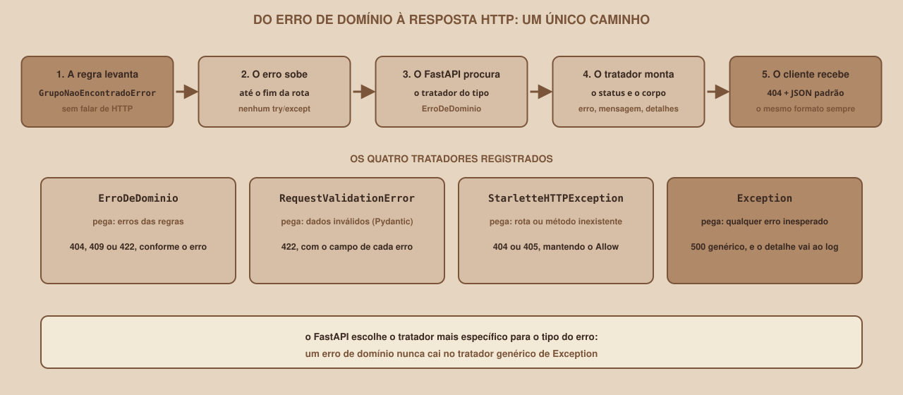

# Módulo 16, Tratamento Global de Erros

Português · [English](../docs-eng/16-global-error-handling.md)

`SEM 05 // API RESTful Central`

---

## // Antes de começar

> **TRILHA VETERANO**
> Este módulo faz parte da trilha veterano: ele vem depois do conteúdo essencial e não é necessário para o entregável da semana. Quem segue a trilha principal pode pular para o `entregavel.md`.

No Módulo 15 as regras passaram a levantar erros que não conhecem o HTTP, como `GrupoNaoEncontradoError`. Falta a peça que fecha o ciclo: **quem transforma cada erro em uma resposta**. Este módulo apresenta os *exception handlers* (tratadores de exceção) do FastAPI, que fazem isso em **um único lugar**, e define um formato de erro igual para toda a API. O código completo está em `example/api-limpa/app/api/erros.py`.

## // O problema: cada erro com a sua cara

Na API da trilha principal, o cliente recebe erros em formatos diferentes, dependendo de onde eles nascem. Estas são respostas reais:

| Situação | Corpo da resposta | Formato |
|---|---|---|
| Grupo inexistente (`404`) | `{"detail":"Grupo não encontrado"}` | `detail` é um **texto** |
| Dados inválidos (`422`) | `{"detail":[{...}]}` | `detail` é uma **lista** de objetos |
| Rota que não existe (`404`) | `{"detail":"Not Found"}` | `detail` em inglês |
| Método não permitido (`405`) | `{"detail":"Method Not Allowed"}` | `detail` em inglês |
| Erro de programação (`500`) | `Internal Server Error` | **Texto puro**, nem é JSON |

Quem escreve um cliente (uma tela, outro programa) precisa tratar cinco formatos diferentes só para ler uma mensagem de erro. E, em uma API que cresce, cada rota tende a inventar mais um jeito.

## // O que é um exception handler

> **EXCEPTION HANDLER: EM PALAVRAS SIMPLES**
> É uma função que você registra para um **tipo de exceção**. Sempre que uma exceção daquele tipo sobe até o fim de uma rota sem ser tratada, o FastAPI chama essa função, e o que ela devolver vira a resposta.

<div align="center">

</div>

A vantagem é dupla: as **regras** não precisam saber de HTTP (elas só levantam o erro), e as **rotas** não precisam de `try/except` (o erro sobe sozinho até o tratador).

## // Um formato único de erro

Primeiro, decide-se **como todo erro vai se parecer**. Nesta API, é sempre um objeto com três campos:

```json
{
  "erro": "grupo_nao_encontrado",
  "mensagem": "Grupo não encontrado",
  "detalhes": null
}
```

| Campo | O que é |
|---|---|
| `erro` | Um código curto e estável, feito para **programas** lerem (não muda se a mensagem for traduzida) |
| `mensagem` | O texto para **pessoas** lerem |
| `detalhes` | Uma lista com os pontos específicos do problema (usada na validação), ou `null` |

O código monta essa resposta em uma só função:

```python
def resposta_de_erro(status_code: int, erro: str, mensagem: str, detalhes=None, headers=None) -> JSONResponse:
    corpo = {"erro": erro, "mensagem": mensagem, "detalhes": detalhes}
    return JSONResponse(status_code=status_code, content=corpo, headers=headers)
```

## // Tratador 1: os erros de domínio

Aqui entra o mapa que faltava: qual **código de status** cada erro de domínio vira. Ele existe em **um** lugar, e só na camada de API:

```python
STATUS_POR_ERRO = {
    GrupoNaoEncontradoError: 404,
    MateriaNaoEncontradaError: 404,
    MateriaInexistenteError: 422,
    GrupoDuplicadoError: 409,
}


def registrar_tratadores(app: FastAPI) -> None:
    @app.exception_handler(ErroDeDominio)
    async def tratar_erro_de_dominio(request: Request, erro: ErroDeDominio):
        return resposta_de_erro(STATUS_POR_ERRO.get(type(erro), 400), erro.codigo, erro.mensagem)
```

O tratador é registrado para `ErroDeDominio`, a **classe base**. Por isso ele pega também todas as filhas (`GrupoNaoEncontradoError` e as outras). Respostas reais:

```
GET /grupos/99

404  {"erro":"grupo_nao_encontrado","mensagem":"Grupo não encontrado","detalhes":null}

POST /grupos   {"nome_grupo":"Grupo fantasma","materia_id":99}

422  {"erro":"materia_inexistente","mensagem":"A matéria 99 não existe","detalhes":null}
```

Repare que as rotas não mudaram nada: `buscar_grupo` continua sendo `return servico.buscar(grupo_id)`. O erro sobe sozinho.

## // Tratador 2: os erros de validação do FastAPI

Os `422` automáticos (dados inválidos) também podem ser traduzidos para o formato único, com o tipo `RequestValidationError`:

```python
@app.exception_handler(RequestValidationError)
async def tratar_validacao(request: Request, erro: RequestValidationError):
    detalhes = [{"campo": ".".join(str(parte) for parte in e["loc"]), "mensagem": e["msg"]} for e in erro.errors()]
    return resposta_de_erro(422, "validacao", "Os dados enviados são inválidos", detalhes)
```

O `loc` que você conhece (`["body", "nome_grupo"]`) vira o texto `body.nome_grupo`. Duas respostas reais:

```
POST /grupos   {"nome_grupo":"ab","materia_id":0}

422  {"erro":"validacao","mensagem":"Os dados enviados são inválidos","detalhes":[
       {"campo":"body.nome_grupo","mensagem":"String should have at least 3 characters"},
       {"campo":"body.materia_id","mensagem":"Input should be greater than 0"}]}

GET /grupos/abc

422  {"erro":"validacao","mensagem":"Os dados enviados são inválidos","detalhes":[
       {"campo":"path.grupo_id","mensagem":"Input should be a valid integer, unable to parse string as an integer"}]}
```

(Os `detalhes` foram quebrados em várias linhas aqui para caber na página; a resposta real vem em uma linha só.) O `PATCH` com `null` do Módulo 09 passa pelo mesmo caminho, e a resposta aponta `body.nome_grupo`.

## // Tratador 3: os erros HTTP do próprio framework

Quando a rota nem existe, ou o método não é aceito, quem levanta o erro é o framework, com a classe `HTTPException` do Starlette (a base sobre a qual o FastAPI é construído):

```python
CODIGO_POR_STATUS = {404: "nao_encontrado", 405: "metodo_nao_permitido"}
MENSAGEM_POR_STATUS = {404: "Recurso não encontrado", 405: "Método não permitido para este recurso"}


@app.exception_handler(StarletteHTTPException)
async def tratar_erro_http(request: Request, erro: StarletteHTTPException):
    codigo = CODIGO_POR_STATUS.get(erro.status_code, "erro_http")
    mensagem = MENSAGEM_POR_STATUS.get(erro.status_code, str(erro.detail))
    return resposta_de_erro(erro.status_code, codigo, mensagem, headers=getattr(erro, "headers", None))
```

Uma observação importante: o tratador é registrado para a classe do **Starlette**, e não para a do FastAPI. A `HTTPException` do FastAPI é uma filha da do Starlette, então registrar a classe-mãe pega as duas.

```
GET /nada

404  {"erro":"nao_encontrado","mensagem":"Recurso não encontrado","detalhes":null}

DELETE /grupos

405  {"erro":"metodo_nao_permitido","mensagem":"Método não permitido para este recurso","detalhes":null}
     allow: GET
```

O parâmetro `headers=` existe para **não perder o cabeçalho** `allow` do `405`, que informa ao cliente quais métodos a rota aceita. Um tratador que esquece os cabeçalhos da exceção original apaga informação útil.

## // Tratador 4: o erro inesperado

O último tratador é o de rede de segurança: qualquer erro que **ninguém previu** (um bug, uma divisão por zero):

```python
@app.exception_handler(Exception)
async def tratar_erro_inesperado(request: Request, erro: Exception):
    logger.exception("Erro inesperado em %s %s", request.method, request.url.path)
    return resposta_de_erro(500, "erro_interno", "Erro interno do servidor")
```

Duas decisões de segurança estão nesse código:

- **O cliente não recebe o detalhe.** A resposta é sempre a mesma mensagem genérica. Detalhes internos (nomes de arquivos, trechos de código, valores) ajudam quem quer atacar o sistema.
- **O detalhe vai para o log.** O `logger.exception` registra o erro completo, com a cadeia de chamadas, para quem mantém a API investigar.

Testado em um servidor real, com uma rota que levanta `RuntimeError("detalhe interno secreto")`:

```
(o que o cliente recebe)
HTTP/1.1 500 Internal Server Error
{"erro":"erro_interno","mensagem":"Erro interno do servidor","detalhes":null}

(o que o log do servidor registra)
Erro inesperado em GET /quebra
    def quebra(): raise RuntimeError("detalhe interno secreto")
RuntimeError: detalhe interno secreto
INFO:     127.0.0.1:43836 - "GET /quebra HTTP/1.1" 500 Internal Server Error
```

O cliente nunca viu a palavra "secreto". O log guardou tudo.

> **UM DETALHE SOBRE TESTES**
> Em um teste, o `TestClient` **levanta de novo** o erro inesperado, mesmo com o tratador respondendo `500`. Isso é proposital (para que testes não escondam bugs). Para testar o `500` em JSON, crie o cliente assim: `TestClient(app, raise_server_exceptions=False)`.

## // O tratador certo para cada erro

O FastAPI escolhe o tratador pelo **tipo** do erro, do mais específico para o mais geral. Por isso a ordem de registro não importa, e um erro de domínio **nunca** cai no tratador genérico de `Exception`:

| Tipo do erro | Tratador | Resposta |
|---|---|---|
| `GrupoNaoEncontradoError` (e as irmãs) | `ErroDeDominio` | `404`, `409` ou `422` |
| Dados que o Pydantic recusou | `RequestValidationError` | `422` com a lista de campos |
| Rota ou método inexistente | `StarletteHTTPException` | `404` ou `405` |
| Qualquer outra coisa | `Exception` | `500` genérico, e o detalhe vai ao log |

## // Documentando o formato no Swagger

Um problema aparece: o FastAPI continua descrevendo o `422` com o **formato antigo** na documentação, mesmo que a API devolva o novo. A resposta real do `/openapi.json`, antes da correção, para `GET /grupos/{grupo_id}`:

```
200 -> GrupoOut     404 -> ErroOut     422 -> HTTPValidationError
```

O `422` ainda apontava para o modelo padrão do FastAPI. A correção é declarar o modelo de erro no `responses` do **router**, o que vale para todas as rotas dele:

```python
router = APIRouter(
    prefix="/grupos",
    tags=["grupos"],
    responses={422: {"model": ErroOut, "description": "Dados inválidos (formato único de erro)"}},
)
```

Depois da correção:

```
200 -> GrupoOut     422 -> ErroOut     404 -> ErroOut
```

Agora o Swagger e a API contam a mesma história. Lembre: a documentação é uma promessa, e um cliente que a lê precisa poder confiar nela.

## // Registrando os tratadores

No `main.py`, uma linha liga tudo:

```python
app = FastAPI(title="API Central: Buscador de Grupos de Estudo", ...)

registrar_tratadores(app)
app.include_router(materias.router)
app.include_router(grupos.router)
```

A função `registrar_tratadores` recebe o `app` e registra os quatro. Isso mantém o `main.py` pequeno e deixa todo o tratamento de erros em **um único arquivo**, fácil de ler e de testar.

## // Bom exemplo × mau exemplo

**Mau exemplo**: um `try/except` em cada rota:

```python
@router.get("/{grupo_id}")
def buscar_grupo(grupo_id: int, servico: ServicoGruposDep):
    try:
        return servico.buscar(grupo_id)
    except GrupoNaoEncontradoError:
        raise HTTPException(status_code=404, detail="Grupo não encontrado")
```

A tradução do erro vira **código repetido** em toda rota, o formato do erro depende de quem escreveu cada uma, e esquecer o `except` em uma rota vira um `500`.

**Bom exemplo**: a rota não trata nada, e o tratador global traduz:

```python
@router.get("/{grupo_id}")
def buscar_grupo(grupo_id: int, servico: ServicoGruposDep):
    return servico.buscar(grupo_id)
```

## // Erros comuns

| Erro | Por que acontece | Como corrigir |
|---|---|---|
| O tratador nunca é chamado | Foi registrado para a classe errada, ou o `registrar_tratadores(app)` não foi chamado | Confira o tipo do erro e a linha no `main.py` |
| O `405` perdeu o cabeçalho `allow` | O tratador não repassou os cabeçalhos da exceção | Use `headers=getattr(erro, "headers", None)` |
| O cliente recebe detalhes internos no `500` | O tratador devolve `str(erro)` | Devolva uma mensagem fixa e registre o detalhe no log |
| O Swagger mostra o formato de erro antigo | O `responses` não declara o modelo novo | Declare `responses={422: {"model": ErroOut}}` no router |
| O teste do `500` levanta a exceção | O `TestClient` re-levanta erros inesperados | Use `raise_server_exceptions=False` |
| Um erro de domínio novo vira `400` | Ele não está no `STATUS_POR_ERRO` | Acrescente o tipo ao mapa |

## // Prática guiada

1. Leia o `app/api/erros.py` inteiro e ligue cada função ao tratador da tabela.
2. Rode a API (`fastapi dev app/main.py`) e provoque cada resposta do módulo: `GET /grupos/99`, `GET /grupos/abc`, `GET /nada`, `DELETE /grupos`. Confira o formato único em todas.
3. Compare cada resposta com a da API da trilha principal (a tabela do início do módulo).
4. Acrescente temporariamente uma rota que levante um erro qualquer, chame-a, e compare o que o cliente recebeu com o que o terminal registrou.

## // Pratique sozinho

> **DESAFIO**
> Acrescente uma regra nova ao domínio: nomes reservados, como `admin`, não podem ser usados como nome de grupo. Crie o erro `NomeReservadoError` em `dominio/erros.py`, levante-o no `criar` do serviço, e registre-o no `STATUS_POR_ERRO` com o status `422`. Confira que você tocou em **três** lugares (domínio, aplicação e API) e que **nenhuma rota** precisou mudar. Escreva um teste que confirme o `422` e o código `nome_reservado`.

## // Aplicando no projeto da semana

1. Se você seguiu a trilha veterano, crie o `app/api/erros.py` na sua API em camadas e registre os quatro tratadores no `main.py`.
2. Declare o `ErroOut` nos `responses` dos seus routers.
3. Se você versiona o projeto com Git, faça um commit: `git commit -m "Adiciona tratamento global de erros"`.

## // Checkpoint

> **ANTES DE SEGUIR, PENSE NISTO**
> Um erro de domínio `GrupoNaoEncontradoError` é um filho de `ErroDeDominio`, que por sua vez é um filho de `Exception`. Existem tratadores registrados para os dois. Qual deles responde, e por quê?

Resposta: o de `ErroDeDominio`. O FastAPI procura o tratador do tipo **mais específico** que serve ao erro, e `ErroDeDominio` é mais específico que `Exception`. O de `Exception` só responde por erros que nenhum outro tratador reconhece. É por isso que um grupo inexistente vira `404` com o formato único, e só um bug de verdade vira `500`.

## // Resumo do módulo

- [ ] Sei o que é um exception handler e quando o FastAPI o chama.
- [ ] Sei definir um formato único de erro (`erro`, `mensagem` e `detalhes`).
- [ ] Sei mapear erros de domínio para códigos de status em um só lugar.
- [ ] Sei traduzir os erros de validação e os erros HTTP do próprio framework.
- [ ] Sei por que o `500` não devolve detalhes ao cliente, e onde eles ficam registrados.
- [ ] Sei documentar o formato de erro no Swagger com `responses`.

---

**Próximo módulo:** `17-testes-automatizados.md`: um módulo bônus da trilha veterano, ou `entregavel.md` para a revisão final.

`Material de Estudo // Coffee & Code`
